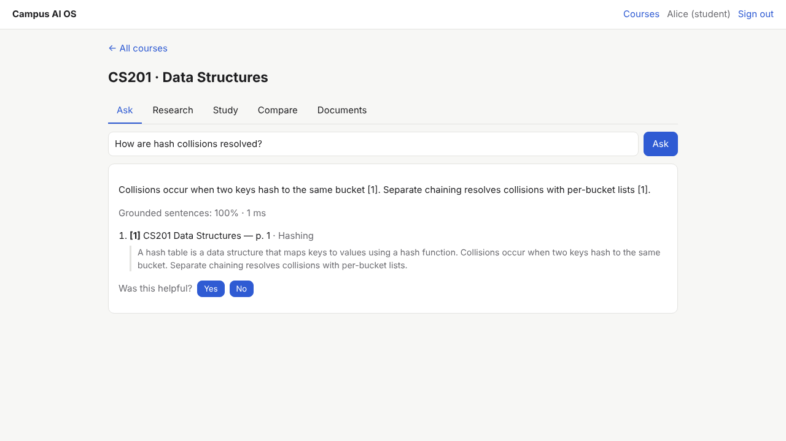

# Campus AI OS

A multi-tenant course knowledge platform. Instructors upload lecture notes, slides (PDF), handouts and syllabi. Students ask questions and get answers built only from that material, with a citation (document, page, section) on every sentence. The platform abstains when the material does not contain the answer. Study tools (flashcards, quizzes, research view, document comparison) are generated from the same text, so every item points back to a page. Instructors see analytics designed so that no individual student's questions can be identified.



**Status:**

- **Working vertical slice, verified end to end.** The browser test covers upload → question → cited answer, abstention, flashcards, quiz and analytics.
- **Tests:** 39 backend tests run against real PostgreSQL + pgvector, and an independent security audit found 10 defects, all fixed.
- **Not yet:** deployed, or tried with real students (see the [beta plan](docs/beta-plan.md)).

## Features

| Area | What exists |
|---|---|
| Accounts | Email + password (scrypt) and HttpOnly session cookies; logout and password changes revoke sessions; self-service account deletion |
| Roles (RBAC) | Platform: admin, faculty, student. Course: instructor, student. Students join a course with a join code. Instructors can be added and removed, but never the last one. |
| Course workspaces | Each course is an isolated retrieval tenant. Members only; any other id returns 404. |
| Documents | PDF (page-aware), Markdown, HTML, text. Upload is idempotent. Deleting a document also deletes its flashcards and any quizzes that quote it. |
| Ask | Grounded extractive answers with sentence-level citations and a grounding score. Abstains when the material doesn't cover the question. Chunks that look like prompt injection are left out. |
| Research mode | RM3-expanded retrieval with reranking; evidence sentences grouped by document, with pages |
| Study mode | Flashcards built from definitional sentences. Cloze-style multiple-choice quizzes: answers are hidden until the student submits, and the results show each answer's source page. |
| Compare | Key terms shared by two documents and distinctive to each, plus matching sections with similarity scores |
| Analytics | k-anonymous (k = 5) aggregates: question volume, abstention rate, topics, most-cited documents, feedback, quiz scores |
| Quotas | Daily questions per user and storage per course. Both stay correct when requests run concurrently. |
| Feedback | Thumbs up/down and a comment, on your own answers only |
| Admin | Users, roles, disable (which revokes sessions), per-user quotas, platform stats. Admins cannot read course content. |

## Architecture

```
React SPA ──cookie──► FastAPI routes ──► Campus service (authz, quotas, k-anonymity) ──► Groundwork engine (tenant per course)
                                              └─► study tools (extractive)                └─► PostgreSQL + pgvector
```

The retrieval and grounding engine is [Groundwork](../groundwork), developed alongside this repository and used here as a library. It provides BM25, LSA embeddings, RM3, reranking, citation validation and injection filtering. Details: [docs/architecture.md](docs/architecture.md).

## Engineering trade-offs

- **Extraction, not generation.** Answers and study items are sentences from the course material, so nothing is invented. The cost: answers are not synthesised across sources, and flashcards only appear where the text defines its terms ([ADR 0002](docs/decisions/0002-extractive-study-tools.md)).
- **Course = tenant.** Isolation is enforced twice: membership checks in the service and tenant scoping in the engine ([ADR 0001](docs/decisions/0001-course-as-tenant.md)).
- **Privacy over insight.** Instructors see only aggregates where at least 5 eligible students contributed ([ADR 0003](docs/decisions/0003-k-anonymous-analytics.md)).
- **Single process.** Simple and correct, but not horizontally scalable as is.

## Build, test, run

```bash
pip install -e ../groundwork -e 'backend[dev]'
(cd frontend && npm ci && npm run build)
cd backend && pytest                                   # 39 tests, needs PostgreSQL with pgvector on 127.0.0.1:5432
cd ../frontend && npx playwright test                  # browser E2E: starts the real server on a fresh database
```

To run it yourself, see [docs/deployment.md](docs/deployment.md).

## Evidence

- [docs/testing.md](docs/testing.md), plus logs in `test-logs/` and screenshots in `docs/screenshots/`.
- [docs/audit.md](docs/audit.md): 10 security and privacy defects, all reproduced and then fixed (2 high: demoted faculty kept instructor rights; analytics could identify individual students). The browser test also found a stemming defect in Groundwork, which was fixed there.
- [SECURITY.md](SECURITY.md): the threat model and which test covers each control.

## Known limitations

[docs/limitations.md](docs/limitations.md):

- No real users yet.
- No LLM, so answers are extractive.
- Study tools depend on definitional sentences in the material.
- Single process.
- No SSO or MFA.
- Docker and CI were not run (Docker Hub and GitHub were unreachable from the build environment).

## Roadmap

1. Run a beta with 1–2 courses and measure real usage ([plan](docs/beta-plan.md)).
2. An optional LLM provider for synthesised answers, keeping citation and grounding checks.
3. OIDC sign-in with the university's identity provider; email verification.
4. Advisory locks and a shared index, for multiple replicas.
5. Spaced-repetition scheduling for flashcards.

License: not yet chosen by the owner.
