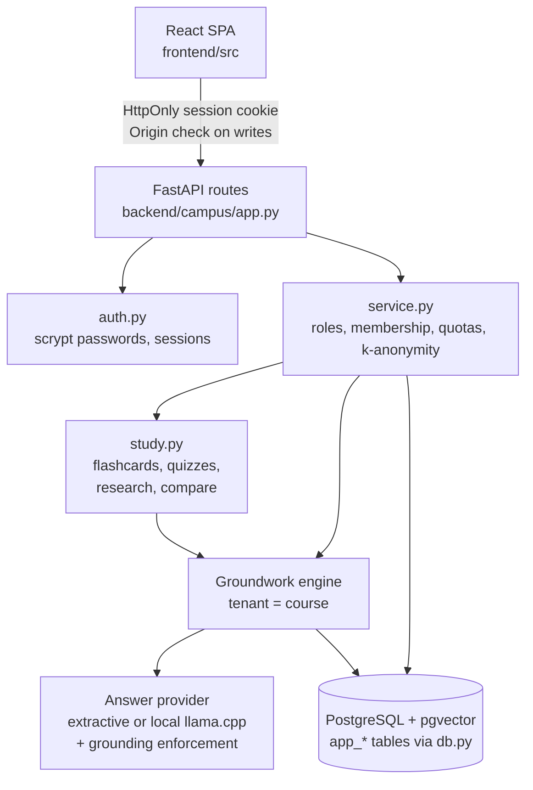

# Campus AI OS

A multi-tenant course Q&A and study platform (FastAPI + React) in which every answer is built from the course's own material and cites a document, page and section.

[](https://github.com/siddhaantxsingh/PROJECTS/actions/workflows/campus-ai-os.yml)


Instructors upload lecture notes, slides (PDF), handouts and syllabi. Students ask questions and get answers with a citation on every sentence, or an abstention when the material does not cover the question. Flashcards, quizzes, a research view and document comparison are generated from the same text, so every item points back to a page. Instructors see analytics designed so that no individual student can be identified. Retrieval and grounding come from [Groundwork](../groundwork), used as a library.

**Status:** a working vertical slice, verified end to end in a browser. **Not deployed, and no real users yet.**


## Highlights

- **Cited answers or abstention.** Upload → question → answer with page-level citations, plus abstention on an off-topic question, is covered by a Chromium browser test against the real server and a fresh PostgreSQL database, run in CI.
- **Course = isolated tenant.** Isolation is enforced twice: membership checks in the service and tenant scoping in the Groundwork engine. Non-members get 404 for every course resource, and admins cannot read course content.
- **Security found and fixed by test.** An independent security and privacy review found 10 defects (2 high: demoted faculty kept instructor rights; analytics could identify single students). Each was reproduced and fixed with a regression test ([audit](docs/audit.md)).
- **Privacy-preserving analytics.** Instructors see only aggregates with at least k = 5 distinct eligible students per figure ([ADR 0003](docs/decisions/0003-k-anonymous-analytics.md)).
- **Quotas that hold under concurrency.** Before the fix, 20 parallel questions with a quota of 1 recorded 4, and 10 parallel uploads reached 2× the storage quota. Both are now covered by concurrency tests.
- **Optional local LLM answers, still checked.** With `CAMPUS_LLM_PROVIDER=llamacpp`, Qwen2.5-0.5B-Instruct writes the answer and every sentence is checked against its cited source. Verified in an opt-in browser test ([log](docs/evidence/2026-10-15/e2e-llm.log), [screenshot](docs/screenshots/ask-llm.png)). Extractive answers stay the default.

## Architecture



The FastAPI layer only routes; every authorization decision is made in `service.py`, which checks platform role, course membership and role, quotas and the k-anonymity rule on each operation. Each course maps to a Groundwork tenant, so parsing, page-bounded chunking, BM25 and LSA retrieval, RM3, reranking, citation checks and injection filtering all run per course. Study tools are extraction and retrieval over the course's own text, so no item is invented. App tables and Groundwork tables live in the same PostgreSQL database. The process is single-instance, with per-course locks around uploads. Details: [docs/architecture.md](docs/architecture.md).

## Features

| Area | What exists |
|---|---|
| Accounts and roles | Email + password (scrypt), HttpOnly session cookies, revocation on logout and password change, self-service deletion. Platform roles admin, faculty, student; course roles instructor, student; join by code. |
| Documents | PDF (page-aware), Markdown, HTML, text. Idempotent upload. Deleting a document also deletes its flashcards and quizzes that quote it. |
| Ask | Grounded extractive answers with sentence-level citations and a grounding score, or local LLM answers with the same checks. Chunks that look like prompt injection are excluded. |
| Research and compare | RM3-expanded retrieval with evidence grouped by document; shared and distinctive terms and matching sections for two documents. |
| Study | Flashcards from definitional sentences; cloze-style quizzes whose answers stay hidden until submission. |
| Analytics, quotas, feedback, admin | k-anonymous aggregates; per-user daily questions and per-course storage; feedback on your own answers only; user, role and quota admin. |

## Quick start

Needs Python 3.11+, Node 22 and PostgreSQL with pgvector on `127.0.0.1:5432` (user `postgres`). Run from the monorepo root, since Groundwork is a sibling directory.

```bash
docker run -d -p 5432:5432 -e POSTGRES_HOST_AUTH_METHOD=trust pgvector/pgvector:pg16

cd campus-ai-os
pip install -e ../groundwork -e 'backend[dev]'
(cd backend && pytest)                          # 39 backend tests on real PostgreSQL + pgvector
cd frontend && npm ci && npm run build
npx playwright install chromium
CHROMIUM_PATH=$(node -e "console.log(require('playwright').chromium.executablePath())") \
  npx playwright test                           # starts the real server on a fresh database
```

To run the app yourself (environment variables, TLS, backups), see [docs/deployment.md](docs/deployment.md). `scripts/e2e-server.sh` shows a minimal local configuration.

## Results

There are no usage results: the product has not been put in front of students or faculty. What has been measured is correctness:

| Suite | Result | Evidence |
|---|---|---|
| Backend API tests (real PostgreSQL + pgvector) | 39 passed | [test-logs/pytest-2026-10-14.txt](test-logs/pytest-2026-10-14.txt) |
| Browser E2E, default (Chromium) | 1 passed | [e2e-default.log](docs/evidence/2026-10-15/e2e-default.log) |
| Browser E2E, local LLM (opt-in, not in CI) | 1 passed in 4.2 min on a heavily loaded CPU | [e2e-llm.log](docs/evidence/2026-10-15/e2e-llm.log) |
| Docker image build and smoke test | SMOKE OK | [docker-smoke-default.log](docs/evidence/2026-10-15/docker-smoke-default.log) |

Answer quality is that of Groundwork; its retrieval and generation benchmarks are in [groundwork/docs/benchmarks.md](../groundwork/docs/benchmarks.md). In those benchmarks Qwen2.5-0.5B abstained on 65 % of queries after grounding enforcement.

## How correctness is verified

- **Backend tests** (`backend/tests/`, 27 feature tests + 12 audit regressions): vertical slice with page citations, abstention, RBAC and course isolation, CSRF, login limits, cookie flags, quiz answer hiding and grading, quotas under concurrency, k-anonymous analytics, document, account and course deletion (including crash-resume), admin actions. Inventory: [docs/testing.md](docs/testing.md).
- **Browser E2E** (`frontend/e2e/campus.spec.ts`): an admin promotes a user to faculty, who creates a course and uploads a document; a student joins by code, gets a cited answer and an abstention, browses flashcards and takes a quiz; instructor analytics stay hidden below k.
- **Audit regressions:** each of the 10 defects in [docs/audit.md](docs/audit.md) has a test.
- **CI:** [`.github/workflows/campus-ai-os.yml`](../.github/workflows/campus-ai-os.yml) runs the backend tests, the frontend type check and build, and the Playwright test on GitHub Actions. It also runs when Groundwork changes.
- **Threat model:** [SECURITY.md](SECURITY.md) maps each control to the test that covers it.

## Design decisions

- **Course = tenant.** Isolation is checked in the service and again in the engine, so a document id from another course is simply not in the index ([ADR 0001](docs/decisions/0001-course-as-tenant.md)).
- **Extraction by default, generation opt-in.** Answers and study items are sentences from the material, so nothing is invented. A local LLM can write answers, but its sentences are kept only if their cited source supports them, so it often abstains ([ADR 0002](docs/decisions/0002-extractive-study-tools.md)).
- **Privacy over insight.** k-anonymity (k = 5) with a membership-age rule, not differential privacy ([ADR 0003](docs/decisions/0003-k-anonymous-analytics.md)).
- **Single process.** Simple and correct; multiple replicas would need PostgreSQL advisory locks and a shared index.

## Limitations and status

- **Not deployed and no real users.** No usage, retention or satisfaction data exists. A beta is planned, not run ([beta plan](docs/beta-plan.md)).
- **LLM answers come from a very small local model** and are slow on CPU: one answer took up to 333 s on the overloaded shared machine ([api-llm.log](docs/evidence/2026-10-15/api-llm.log)). In that API check both on-topic questions ended in abstention after enforcement.
- Study tools depend on definitional sentences in the material.
- No email verification, password reset, SSO or MFA.
- Single process; Chromium is the only browser tested.

Full list: [docs/limitations.md](docs/limitations.md). Requirement status, including the BLOCKED licence decision: [docs/requirements.md](docs/requirements.md).

## Repository layout

```
campus-ai-os/
├── backend/
│   ├── campus/          # app.py (routes), service.py (authz, quotas), study.py, auth.py, db.py
│   └── tests/           # API, security and audit regression tests
├── frontend/
│   ├── src/             # React SPA
│   └── e2e/             # Playwright browser tests
├── docs/                # architecture, ADRs, audit, testing, deployment, evidence, screenshots
├── scripts/             # E2E server, Docker build and smoke test
└── Dockerfile
```

## Documentation

- [Architecture](docs/architecture.md) and [design decisions](docs/decisions/)
- [Testing](docs/testing.md), [audit](docs/audit.md) and [security](SECURITY.md)
- [Requirements matrix](docs/requirements.md) and [limitations](docs/limitations.md)
- [Deployment](docs/deployment.md) and [beta plan](docs/beta-plan.md)
- [Scorecard](docs/scorecard.md)

---

Built by Siddhant Singh ([@siddhaantxsingh](https://github.com/siddhaantxsingh)). Licence: not yet chosen.
