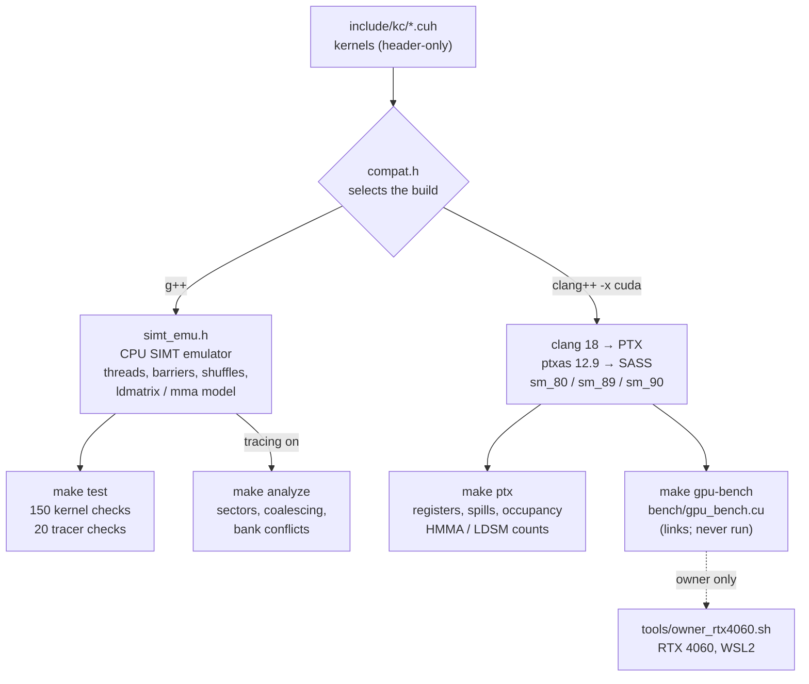

# CUDA kernels

CUDA kernels written as optimisation progressions (reduction, transpose, SGEMM, softmax, LayerNorm, flash attention, a tensor-core GEMM and two backward passes), plus a CPU SIMT emulator that runs the same source to test them and trace every memory access.

[](https://github.com/siddhaantxsingh/PROJECTS/actions/workflows/cuda-kernels.yml)


> **These kernels have never run on a physical GPU.** They are verified functionally on a CPU SIMT emulator and compiled to real SASS for sm_80, sm_89 and sm_90. No GPU timings exist, so no GFLOP/s or GB/s figures are claimed. The memory figures below are **modelled** from emulator traces, not measured. The owner's RTX 4060 run is scripted in [`tools/owner_rtx4060.sh`](tools/owner_rtx4060.sh); see [docs/OWNER_ACTIONS.md](docs/OWNER_ACTIONS.md).

## Highlights

- **150 checks against double-precision references, 0 failures**, all on the emulator: 100 for the original fp32 kernels and 50 for the tensor-core GEMM, fp16 helpers and backward passes ([log](docs/evidence/2026-10-15/make_test.log)).
- **Tensor-core GEMM in inline PTX.** fp16 inputs, fp32 accumulation, `mma.sync.m16n8k16` fed by `ldmatrix`. The SASS contains 32 `HMMA.16816.F32` and 12 `LDSM` per kernel on sm_80, sm_89 and sm_90 ([SASS excerpt](docs/evidence/2026-10-15/sass_hgemm_excerpt.txt)). On the emulator at 256³, its worst error is 0.009 of the fp32 error bound.
- **An emulator that models tensor-core fragments.** `ldmatrix` and `mma.m16n8k16` are modelled at warp level from the PTX ISA layout tables, so a kernel that loads fragments in the wrong layout gives wrong numbers. Mutated layouts fail the suite ([mutations](docs/evidence/2026-10-15/mutations.log)).
- **Optimisation steps with traced effects** (modelled): padding a transpose tile cuts the bank-conflict factor 16.5 → 1.0; SGEMM register blocking cuts global bytes requested 69 MB → 1.3 MB at 256³; flash attention requests 2.4 MB against 142 MB unfused at N = 512.
- **All 23 kernels compile with 0 bytes of stack and 0 spills** for sm_80, sm_89 and sm_90 (clang 18 + ptxas 12.9). The first SGEMM and flash versions spilled 288 and 640 bytes per thread until their loops were unrolled.
- **A GPU toolchain without a GPU.** A CUDA toolkit root built from NVIDIA's PyPI wheels, plus a small `fatbinary` shim, links a complete benchmark binary for sm_80 and sm_89 in CI.

## Architecture



One source builds three ways. `include/kc/compat.h` turns the kernels into real CUDA under clang or nvcc, or into host C++ under g++. On the host, `simt_emu.h` runs each thread block as real OS threads, so a missing `__syncthreads()` produces a real data race that the tests catch. With tracing on, every global and shared access is grouped into warp instructions and priced by the documented sector and bank rules. The device path produces cubins whose resource usage and SASS are checked in CI. The benchmark binary links but has only ever been run on a machine with no GPU, where it exits with "CUDA driver version is insufficient" ([log](docs/evidence/2026-10-15/gpu_bench_run_no_gpu.log)). Details: [docs/design.md](docs/design.md).

## Quick start

Needs g++ with C++20. The device build also needs clang 18 and g++-13.

```sh
cd cuda-kernels
make test                          # emulator: 20 tracer + 150 kernel checks (about 2 min)
make analyze                       # traced memory behaviour per kernel (JSON)

tools/fetch_cuda.sh                # CUDA toolkit root from NVIDIA PyPI wheels
make ptx                           # sm_80/89/90: registers, smem, spills, occupancy, HMMA counts
make gpu-bench CUDA_ARCH=sm_89     # links the real benchmark (needs a GPU to run)
python3 tools/report.py            # regenerate docs/analysis.md from results/
```

On a machine with an RTX 4060 (WSL2), the owner runs `tools/owner_rtx4060.sh`. It records the GPU, runs `make test`, builds for sm_89, and runs the benchmark three times under `nvidia-smi dmon` ([OWNER_ACTIONS.md](docs/OWNER_ACTIONS.md)).

## Results (modelled, not measured)

From [docs/analysis.md](docs/analysis.md). Memory figures come from emulator traces; resource figures come from ptxas. **None of this is a timing.**

| kernel progression | before → after |
|---|---|
| transpose: shared tile → padded tile (1024²) | bank-conflict factor 16.5 → **1.0**; 100 % coalesced (naive: 22 %) |
| SGEMM: naive → 32×32 tiles → register-blocked (256³) | global bytes requested 69 MB → 4.5 MB → **1.3 MB** |
| SGEMM register-blocked: contiguous → split micro-tile | shared conflict factor 1.47 → **1.00** (2-way B-read conflicts removed); global coalescing 41.7 % → **100 %** |
| attention: unfused → flash (N = 512, D = 64) | 142 MB → **2.4 MB** requested; 12.5 % → 100 % coalesced |
| tensor-core GEMM (256³) | `ldmatrix` reads conflict-free; kernel-wide conflict factor 1.12 (2-way on A-tile stores, no swizzle) |

| ptxas resources | sm_80 | sm_89 | sm_90 |
|---|---|---|---|
| tensor-core GEMM registers / occupancy | 123–124 / 25 % | 122–126 / 33.3 % | 123–126 / 25 % |
| flash attention (D = 64) registers / occupancy | 245 / 12.5 % | 247 / 12.5 % | 247 / 12.5 % |
| stack and spills, all 23 kernels | 0 / 0 | 0 / 0 | 0 / 0 |

These show *why* one variant should be faster, not *how much*. Caches, replays and instruction scheduling are not modelled.

## How correctness is verified

- **Kernel checks** (`tests/test_kernels.cpp`, 150 checks). Every kernel runs on the emulator against a double-precision reference with a stated error bound: odd shapes such as 129×130×17 and 5×257×3, α/β epilogues, `-inf` and 3·10³⁸ inputs to softmax, LayerNorm with mean 10⁴.
- **Tensor-core GEMM bound.** Inputs are rounded to fp16; the error must stay within (K + 2)·2⁻²³·Σ|aᵢₖbₖⱼ|, which also covers real tensor-core truncation. A check confirms the inputs really pass through fp16, and NaN padding past the K tail proves no out-of-range element is loaded.
- **Backward passes** are checked against analytic formulas, and those formulas against central finite differences.
- **Tracer checks** (`tests/test_tracer.cpp`, 20 checks) pin the access model to patterns with known answers: strides, misalignment, float4, broadcast, predication, bank strides 1/2/32/33.
- **Mutation testing.** Removing a barrier, breaking the online-softmax rescale, `ldmatrix` without `.trans`, a wrong lane-to-row mapping and other deliberate bugs each fail the suite ([mutations.log](docs/evidence/2026-10-15/mutations.log)).
- **CI** ([workflow](../.github/workflows/cuda-kernels.yml)): emulator tests, `make analyze`, device build for three architectures, a no-spill check, an HMMA check, the benchmark link for sm_80 and sm_89, and `bash -n` on the owner script.

Details: [docs/testing.md](docs/testing.md).

## Design decisions

- **Emulator over "trust the compiler".** Without a GPU, a CPU SIMT emulator gives real functional tests and traceable memory behaviour. The cost: it runs blocks sequentially and cannot show inter-block races or warp-divergence effects ([design.md](docs/design.md#the-emulator)).
- **Model the tensor-core fragment layouts.** This makes layout bugs visible without hardware. The risk: if the model and the kernel misread the PTX tables the same way, the tests cannot tell. The GPU benchmark's `mma_probe` check exists to settle that on hardware ([limitations.md](docs/limitations.md)).
- **Error bound with u = 2⁻²³, not 2⁻²⁴.** Real tensor cores truncate inside the adder, so the same tolerance is valid on the emulator and on a GPU ([testing.md](docs/testing.md#tensor-core-gemm-tolerance)).
- **clang + ptxas from PyPI, not nvcc.** It is the only toolchain available here; nvcc may make different register and unrolling choices ([design.md](docs/design.md#device-toolchain-without-a-gpu)).
- **Thread-per-row flash attention.** Simple and fully coalesced, at the cost of 245 registers and 12.5 % occupancy; FlashAttention-2 splits rows across a warp.

## Limitations and status

| item | status |
|---|---|
| Functional correctness | VERIFIED on the emulator |
| Compiles to SASS with HMMA for sm_80, sm_89, sm_90 | VERIFIED |
| GPU benchmark harness, owner script | IMPLEMENTED BUT UNVERIFIED (never run on a GPU) |
| **Measured GPU performance** | **BLOCKED**: no GPU here; owner runs [`tools/owner_rtx4060.sh`](tools/owner_rtx4060.sh) |
| cuBLAS comparison, bf16/FP8, `wgmma` (Hopper), attention backward | NOT IMPLEMENTED |

The tensor-core GEMM is a first version: no `cp.async` pipeline, no swizzled shared layout, no split-K. Emulated metrics ignore caches. Full list: [docs/limitations.md](docs/limitations.md).

## Repository layout

```
cuda-kernels/
├── include/kc/   kernels (*.cuh), compat.h, simt_emu.h (emulator), half.h
├── tests/        test_kernels.cpp (150 checks), test_tracer.cpp (20 checks)
├── bench/        gpu_bench.cu (GPU harness with on-GPU correctness checks)
├── tools/        fetch_cuda.sh, device_build.sh, fatbinary_shim.c, sass_check.py,
│                 resources.py, analyze.cpp, report.py, owner_rtx4060.sh
├── results/      analysis.json, resources.json, sass.json
└── docs/         design, testing, analysis, limitations, requirements, evidence
```

## Documentation

- [Design](docs/design.md): kernels, the emulator and its access model, the device toolchain
- [Testing](docs/testing.md) and [analysis](docs/analysis.md)
- [Requirements matrix](docs/requirements.md) and [limitations](docs/limitations.md)
- [Owner actions](docs/OWNER_ACTIONS.md): the GPU run only the owner can do
- [Scorecard](docs/scorecard.md)
- Evidence logs: [docs/evidence/2026-10-15/](docs/evidence/2026-10-15/)

---

Built by [Siddhant Singh](https://github.com/siddhaantxsingh).
