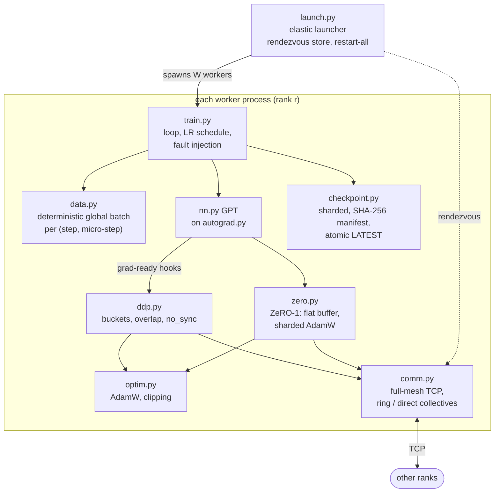

# dtrain: distributed training from scratch

Data-parallel training of a small GPT with no deep-learning framework: a NumPy autograd engine, collectives over TCP, DDP, ZeRO-1, sharded checkpoints and crash recovery. It is cross-checked against PyTorch `torch.distributed` on CPU.

[](https://github.com/siddhaantxsingh/PROJECTS/actions/workflows/distributed-training.yml)


> **Scope.** dtrain runs on CPU only, on one 4-vCPU host, with 1–4 ranks over TCP loopback. The agreement numbers below (with a single process and with PyTorch) are **correctness evidence, not scaling evidence**. There is no GPU, NCCL or multi-host result; those scripts are written for the owner and are BLOCKED ([OWNER_ACTIONS.md](docs/OWNER_ACTIONS.md)).

## Highlights

- **Crash recovery is bit-identical.** A worker killed at step 5 triggers an automatic group restart from the step-3 checkpoint, and the final parameters equal a run with no failure bit for bit, for DDP and ZeRO-1 ([testing.md](docs/testing.md)).
- **DDP equals one process** on the same global batch to ≤ 1e-10 in float64 (4 ranks). Over a 300-step float32 run, the largest per-step loss difference is 2.4e-7.
- **Matches PyTorch DDP (gloo, CPU)** on the same model, data and seed: gradients agree to ≤ 1.6e-15 (float64) and ≤ 1.4e-6 (float32) at 1, 2 and 4 ranks. Ring all-reduce is bit-identical to gloo at 2 ranks ([torch_crosscheck.md](docs/torch_crosscheck.md)).
- **ZeRO-1 matches `ZeroRedundancyOptimizer`** to ≤ 3.9e-14 in float64 after 50 steps, and cuts AdamW state per rank 4× at 4 ranks (6.55 MB → 1.64 MB).
- **Collectives from scratch.** Ring and direct all-reduce, reduce-scatter, all-gather and broadcast over TCP. Large-message bandwidth is about 70–80 % of OpenMPI 4.1 on the same machine; a dead peer raises `CommError` instead of hanging.
- **Honest negative result.** Overlapping all-reduce with backward gave no speed-up here; the likely cause, GIL contention, is not measured ([benchmarks.md](docs/benchmarks.md)).

## Architecture



The launcher runs a key/value store and starts W workers, which connect into a full TCP mesh. The autograd engine fires a hook as soon as a parameter's gradient is final; DDP copies it into a ~1 MiB bucket and all-reduces full buckets. ZeRO-1 instead keeps parameters in one flat buffer, reduce-scatters gradients, runs AdamW on its own shard, and all-gathers the result. Batches are a pure function of the seed and the ring sums in a fixed order, so a restarted run sees the same data and produces the same bits. Details: [docs/architecture.md](docs/architecture.md).

## Quick start

Needs Python 3.10+ and NumPy.

```bash
cd distributed-training
pip install -e '.[dev]'
python -m pytest                                   # 36 tests, about 30 s; each distributed test starts real processes

python -m dtrain.train --mode single --steps 200 --warmup 10
python -m dtrain.launch --nproc 4 -- python -m dtrain.train --mode ddp --steps 200 --warmup 10

# crash at step 50, automatic restart, resume from the last checkpoint
python -m dtrain.launch --nproc 4 --max-restarts 2 -- python -m dtrain.train --mode zero \
    --steps 200 --ckpt-dir ckpt --ckpt-every 20 --resume --fail-at-step 50
```

The first run downloads tiny-shakespeare into `data/` and checks its SHA-256. PyTorch cross-check, optional (a CPU build of `torch` is enough): `python -m pytest tests/test_torch_crosscheck.py` (8 tests) and `python benchmarks/run_torch_crosscheck.py --out <dir>`. Benchmarks: `benchmarks/allreduce_bench.py`, `benchmarks/scaling.sh`, `benchmarks/report.py <date>`.

## Results

### Correctness (agreement)

| comparison | result |
|---|---|
| DDP (4 ranks) vs one process, same global batch | ≤ 1e-10 (float64); max loss diff 2.4e-7 over 300 float32 steps |
| ZeRO-1 vs DDP | ≤ 1e-10 (float64) |
| crash at step 5 → restart → resume | final parameters **bit-identical** to the failure-free run |
| dtrain DDP vs torch DDP (gloo), gradients | ≤ 1.6e-15 (float64), ≤ 1.4e-6 (float32) |
| dtrain DDP vs torch DDP, parameters after 50 AdamW steps | ≤ 5.4e-14 (float64), ≤ 2.3e-5 (float32); mostly from AdamW formula order |
| dtrain ZeRO-1 vs `ZeroRedundancyOptimizer` | ≤ 3.9e-14 (float64), ≤ 1.6e-5 (float32) |
| checkpoint, exit, resume (4 ranks) | dtrain bit-identical; torch DDP + gloo differs by about 5e-16 (cause not found) |

The PyTorch comparison covers one 110k-parameter GPT, 50 steps, 1–4 CPU processes ([tables](docs/torch_crosscheck_tables.md)).

### Performance (single host, 4 vCPUs, loopback)

From [docs/benchmarks.md](docs/benchmarks.md), 2026-10-13: 0.8 M-parameter GPT, float32, 8 × 64 tokens per rank, one BLAS thread per rank. This is weak scaling across the cores of one machine, **not** cluster scaling.

| measurement | result |
|---|---|
| tokens/s, 1 → 4 ranks | 2,577 → 8,697 (DDP, no overlap, 3.37×); 9,266 (ZeRO-1, 3.60×); 8,192 (DDP with overlap, 3.18×) |
| ring all-reduce, 64 MiB, 4 ranks | 0.76 GB/s bus bandwidth, 71 % of OpenMPI 4.1 (1.07 GB/s) |
| small messages (1–64 KiB) | latency 10–50× OpenMPI's (Python overhead per ring step) |
| vs torch DDP (gloo), 2026-10-15, load average 16–21 | torch 2.1–2.8× faster per step, mostly compute kernels; indicative only |

## How correctness is verified

- **36 tests** (`python -m pytest`), plus **8 PyTorch cross-check tests** when `torch` is installed. Every distributed test starts real OS processes.
  - `test_autograd.py` (10): finite-difference gradient checks in float64 for every op and every parameter of a 2-layer GPT.
  - `test_comm.py` (16): ring and direct collectives on 2–4 processes, including empty and uneven chunks, against NumPy to 1e-12 and bit-identical on every rank; a crashed peer raises `CommError`.
  - `test_training.py` (10): DDP = single process, ZeRO = DDP, overlap and bucket size don't change results, gradient accumulation = larger batch, bit-identical preempt/resume and crash recovery, corrupted checkpoint shard rejected.
  - `test_torch_crosscheck.py` (8): collectives, DDP (AdamW and SGD), ZeRO-1 and checkpoint/resume against `torch.distributed`.
- **CI** ([workflow](../.github/workflows/distributed-training.yml)): a `test` job (pytest plus a 2-rank crash-and-restart smoke run) and a `torch-crosscheck` job with torch 2.14.1 CPU.

Details: [docs/testing.md](docs/testing.md).

## Design decisions

- **Fixed summation order.** The ring reduces chunks in a fixed order, so all ranks get identical bits and runs are reproducible. That is what makes bit-identical crash recovery testable ([architecture.md](docs/architecture.md#communication)).
- **Deterministic data per (step, micro-step).** A single process can reproduce a W-rank batch (`--emulate-world`), and a resumed run sees exactly the data it would have seen.
- **Restart-all elasticity.** Any worker failure restarts the whole group from `LATEST`. Simple and exact, but the world size is fixed and checkpoints cannot be re-sharded ([architecture.md](docs/architecture.md#determinism-and-fault-tolerance)).
- **ZeRO-1 over a flat buffer.** Even shards (441,856 B per rank at 4 ranks, float64) instead of PyTorch's whole-tensor assignment (422,912–458,752 B), at the cost of a flat-buffer view of every parameter.
- **Python communication thread.** Easy to reason about, but it shares the GIL with autograd, which is why overlap does not pay off.

## Limitations and status

- **CPU / NumPy only.** No GPU, CUDA or NCCL. The owner scripts (`owner/rtx4060_single_gpu.sh`, `owner/multi_gpu_nccl.sh`) check PyTorch on CUDA against dtrain's CPU result; they are written but **BLOCKED** and have never run ([OWNER_ACTIONS.md](docs/OWNER_ACTIONS.md)).
- **Single host.** Plain TCP, but only loopback was tested; multi-host is IMPLEMENTED BUT UNVERIFIED. Scaling stops at 4 ranks, the number of cores.
- **Throughput** is far below a production framework; the throughput comparison with torch was taken on a heavily loaded machine.
- **ZeRO stage 1 only.** No ZeRO-2/3, tensor or pipeline parallelism, or mixed precision.
- **Rendezvous store** is a single point of failure, with no authentication.

Full list: [docs/limitations.md](docs/limitations.md).

## Repository layout

```
distributed-training/
├── dtrain/        autograd, nn, optim, comm, ddp, zero, checkpoint, data, train, launch, torch_ref
├── tests/         test_autograd, test_comm, test_training, test_torch_crosscheck
├── benchmarks/    all-reduce and scaling benchmarks, PyTorch cross-check, dated results
├── owner/         GPU / NCCL scripts for the owner (never run)
└── docs/          architecture, testing, benchmarks, limitations, requirements
```

## Documentation

- [Architecture](docs/architecture.md)
- [Testing](docs/testing.md) and [benchmarks](docs/benchmarks.md)
- [Cross-check against PyTorch](docs/torch_crosscheck.md) ([tables](docs/torch_crosscheck_tables.md))
- [Requirements matrix](docs/requirements.md) and [limitations](docs/limitations.md)
- [Owner actions (GPU)](docs/OWNER_ACTIONS.md) and [scorecard](docs/scorecard.md)

---

Built by [Siddhant Singh](https://github.com/siddhaantxsingh).
