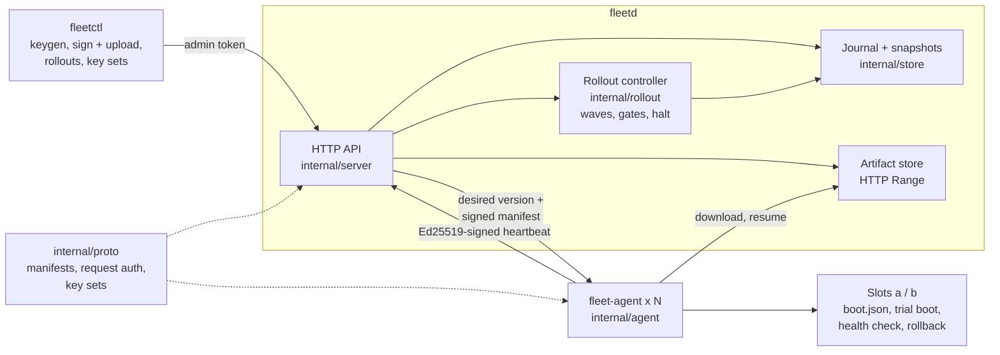

# EdgeFleet

Fleet management and signed over-the-air (OTA) updates for edge devices, in Go with only the standard library: A/B installs with automatic rollback, and staged rollouts that halt a bad release at the canary.

[](https://github.com/siddhaantxsingh/PROJECTS/actions/workflows/edgefleet.yml)


EdgeFleet has a control plane (`fleetd`), a device agent (`fleet-agent`), an admin CLI (`fleetctl`) and a fleet simulator (`fleetsim`). Releases are signed offline and verified on the device. Devices install into the inactive slot, trial-boot the new version, health-check it, and roll back by themselves if it fails. State on both sides survives a crash at any step.

**Status:** verified locally and in CI, including the real binaries running real executable artifacts. **All devices are simulated** (separate agent processes or in-process agents); it has never run on a real board, and the A/B boot is emulated in user space. Single control-plane instance; not deployed.

## Highlights

- **Bad releases stop at the canary.** In a 2,000-device simulation, a release whose every trial fails reached 15 devices (0.75 %) before the health gate halted the rollout; every one of them rolled itself back ([benchmarks](docs/benchmarks.md)).
- **Crash-safe A/B updates.** Tests crash the agent after download, after install, at trial boot and after the health check; each reboot from disk leaves a valid version and converges. A crash loop in the trial is rolled back by the boot counter.
- **Signed releases, verified on the device.** Agents check the Ed25519 signature and SHA-256 of every artifact. Tests modify a stored artifact after upload, and the agents reject it, so a compromised control plane can withhold updates but not make a device run unsigned code.
- **Release-key rotation with rollback protection.** A pinned root key signs a versioned, expiring key set; revoked keys, key-set rollback and modified sets are refused. A tampering proxy test shows devices install nothing it serves. 7 of 7 hand-made mutations of the key-set checks were caught ([log](docs/evidence/2026-10-15/keyset_mutations.log)). This is a small subset of TUF, not TUF.
- **Replay-safe device identity.** Each device enrolls with a single-use token and signs every request over method, path, timestamp, nonce and body hash. Replayed nonces, tampered bodies, changed paths and ±5 min clock skew are rejected.
- **Durable control plane.** CRC-checked journal fsynced per event, plus snapshots. A test cuts the journal at every byte; a control-plane restart mid-rollout keeps the wave and results.

## Architecture



`fleetctl` signs releases with an offline key and uploads them; `fleetd` accepts an upload only if the signature verifies. Each device heartbeats with a signed request that reports its version and the result of its last update; the reply carries the desired version, the signed manifest and an artifact URL. Rollout membership is a deterministic hash of rollout and device id, so waves are stable across restarts without being stored. The controller ticks every second: it halts the rollout if the wave's failure rate exceeds the limit, waits for reports and bake time, then advances. On the device, the agent downloads into the inactive slot, persists the trial in `boot.json`, boots and health-checks the new version, and switches slots only on success. Details and the trust model: [docs/architecture.md](docs/architecture.md).

## Quick start

Needs Go 1.24+. An application is an executable that supports `app run` (the long-running service) and `app health` (exit 0 when healthy).

```bash
cd edgefleet
go test ./...                              # unit, integration and real-binary e2e tests
go build -o bin/ ./cmd/...
go run ./cmd/fleetsim -n 2000              # fleet simulation (3 scenarios)
```

Run one device through an update with the real binaries:

```bash
cd bin
for v in 1.0 2.0; do printf '#!/bin/sh\ncase "$1" in\nrun) exec sleep 3600 ;;\nhealth) exit 0 ;;\nesac\n' > app-$v; chmod +x app-$v; done

PUB=$(./fleetctl keygen -out release.key)
export FLEET_ADMIN_TOKEN=$(head -c 24 /dev/urandom | base64)
./fleetd -data fleet-data -release-pubkey "$PUB" -heartbeat-sec 5 &
./fleetctl release -key release.key -version 1.0 -file app-1.0

mkdir -p dev-1/slots/a && cp app-1.0 dev-1/slots/a/app     # the version the device ships with
TOKEN=$(./fleetctl token | sed -n 's/.*"token": "\(.*\)".*/\1/p')
./fleet-agent -id dev-1 -state "$PWD/dev-1" -token "$TOKEN" -release-pubkey "$PUB" -exec &

./fleetctl release -key release.key -version 2.0 -file app-2.0
./fleetctl rollout -version 2.0 -waves 10,50,100 -max-failure 0.1 -bake 10s   # prints the rollout id
./fleetctl status <rollout-id>
./fleetctl devices
```

Pass an absolute `-state` path when using `-exec`: with a relative path the agent fails to start the app.

Optional release-key rotation (devices pin a root key instead of a release key; this sequence is exercised by `e2e/TestKeyRotationWithRealBinaries`):

```bash
ROOT=$(./fleetctl keygen -out root.key); RELA=$(./fleetctl keygen -out rel-a.key)
./fleetctl keyset -root root.key -set-version 1 -ttl 720h -keys rel-a=$RELA -out ks1.json
./fleetd -data fleet-data -root-pubkey "$ROOT" -keyset ks1.json &      # agents: fleet-agent -root-pubkey "$ROOT" ...
./fleetctl release -key rel-a.key -key-id rel-a -version 2.0 -file app-2.0
RELB=$(./fleetctl keygen -out rel-b.key)                               # rotate to rel-b and revoke rel-a
./fleetctl keyset -root root.key -set-version 2 -ttl 720h -keys rel-b=$RELB -revoke rel-a -out ks2.json
./fleetctl keyset-push -file ks2.json
```

## Results

`fleetsim`: `fleetd` and 2,000 simulated devices in one process on a 4-vCPU VM, heartbeat every 1 s, real HTTP on loopback. Devices really download, hash and verify each 256 KiB artifact and persist their A/B state; only the health outcome is simulated.

| Scenario | Outcome | Time | Devices that tried it | Heartbeats/s | Call latency p50 / p99 |
|---|---|---|---|---|---|
| Good release, waves 1/10/50/100 % | completed; 2,000 on 2.0 | 10.4 s | 2,000 | 1,829 | 1.0 / 905 ms |
| Bad release (every trial fails) | halted in the first wave; all rolled back | 1.4 s | 15 | 1,768 | 0.4 / 17 ms |
| Flaky release (3 % failures, 10 % limit) | completed; 46 failed devices stay on the old version | 10.0 s | 2,000 | 1,742 | 3.7 / 1,436 ms |

Call latency covers the agent's whole heartbeat call, so during a rollout it includes downloading, hashing and trial-booting the release. The bad-release row is mostly plain heartbeats. The high p99 during rollouts comes from journal fsyncs made under the store's single lock. Full results: [docs/benchmarks.md](docs/benchmarks.md); raw JSON: [`bench/results/`](bench/results/).

## How correctness is verified

| Package | What it checks |
|---|---|
| `internal/proto` | key-set rotation lifecycle, forged and malformed sets; manifest signatures; request authentication (replay, tampering, skew, unknown device) |
| `internal/store` | replay, compaction, journal cut at every byte, mid-journal corruption is an error |
| `internal/rollout` | proportional and deterministic wave sizes (20,000 devices), desired-version logic for every state, gate decisions |
| `internal/server` | real HTTP with agents in simulation mode: good, bad and flaky rollouts; abort; tampered artifacts; agent crash at each update step; resumed downloads; control-plane restart mid-rollout; key rotation against a tampering proxy |
| `e2e` | built `fleetd`, `fleet-agent` and `fleetctl` binaries with real shell-script artifacts: update, crash-on-start rollback, agent restart, key rotation |

CI ([workflow](../.github/workflows/edgefleet.yml)) runs `gofmt`, `go vet`, `go test -race ./internal/...`, the e2e tests twice, and a 300-device `fleetsim` run. Latest full local run: [go_test_all.log](docs/evidence/2026-10-15/go_test_all.log). Details: [docs/testing.md](docs/testing.md).

## Design decisions

- **Devices trust signatures, not the server.** Verification happens on the device, so the control plane is not in the code-signing trust path; it can only withhold updates.
- **Rollout membership by hash.** Stable across restarts without storing it, and a different canary set per rollout. The cost: with tiny waves on small fleets the first wave can be empty, and the next wave becomes the canary.
- **A failed device is never retried** in the same rollout, so a flaky release cannot loop on the same device.
- **User-space A/B emulation.** The agent plays the bootloader's role with a boot counter in `boot.json`. The state machine matches a real A/B scheme, but real firmware updates need U-Boot/GRUB or a tool like RAUC or Mender.
- **Standard library only.** No third-party dependencies to audit; the trade-off is hand-written journal, signing protocol and key-set format instead of TUF.

## Limitations and status

- **Simulated devices only.** No real board has run an update. The owner step (a Raspberry Pi or Cortex-M board with a bootloader) is listed in the [owner action plan](../master/OWNER_ACTION_PLAN_20_PROJECTS.md).
- **A/B boot is emulated in user space**; no bootloader integration.
- **Key rotation covers release keys only and is not TUF**: the root key and device keys cannot be rotated, and expiry relies on the device's clock.
- Single control-plane instance, no HA; heartbeats queue behind journal fsyncs under one lock (p99 up to 1.4 s during rollouts at 2,000 devices).
- Full-image updates only; generic health check; one shared admin token; no TLS configured. Not deployed.

Full list: [docs/limitations.md](docs/limitations.md).

## Repository layout

```
edgefleet/
├── cmd/
│   ├── fleetd/        # control plane
│   ├── fleet-agent/   # device agent
│   ├── fleetctl/      # admin CLI: keys, releases, rollouts, key sets
│   └── fleetsim/      # fleet-scale simulation and benchmark
├── internal/
│   ├── agent/         # A/B slots, trial boot, health check, rollback
│   ├── proto/         # manifests, signed requests, key sets
│   ├── rollout/       # waves and health gates
│   ├── server/        # HTTP API, artifacts, controller loop
│   └── store/         # journal and snapshots
├── e2e/               # tests with the built binaries
├── bench/             # report.py, results/
└── docs/              # architecture, benchmarks, testing, limitations, requirements, evidence
```

## Documentation

- [Architecture, trust model and update state machine](docs/architecture.md)
- [Benchmarks](docs/benchmarks.md) and [testing](docs/testing.md)
- [Requirements matrix](docs/requirements.md) and [limitations](docs/limitations.md)
- [Scorecard](docs/scorecard.md)

---

Built by Siddhant Singh ([@siddhaantxsingh](https://github.com/siddhaantxsingh)). No licence file yet.
