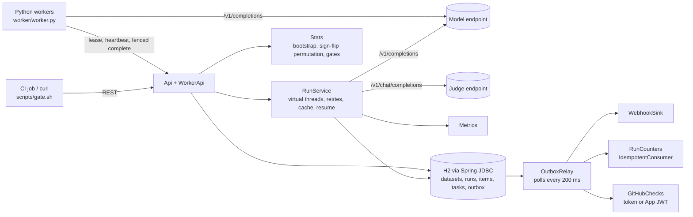

# EvalOps

**An evaluation service for LLM endpoints in Java 21 and Spring Boot 3: versioned datasets, reproducible runs, paired bootstrap comparisons and CI gates that fail only on statistically significant regressions.**

[](https://github.com/siddhaantxsingh/PROJECTS/actions/workflows/evalops.yml?query=branch%3Accr-a6e6c567-y4w7k8)


Changing a model (quantizing it, swapping a prompt, shrinking it) should be tested like changing code. EvalOps stores immutable dataset versions, runs them against any OpenAI-style `/v1/completions` endpoint, scores the outputs, and compares two runs item by item. A gate then says pass or fail, and fails only when a metric dropped by more than the allowed amount **and** the drop is significant. Run events go through a transactional outbox, items can be executed by out-of-process Python workers with fencing tokens, and results can be published as GitHub check runs.

## Highlights

- **Gates that separate regressions from noise.** On 300 held-out code completions, int8 weights pass against f32 (Δ +0.007, p = 0.49) and a 1-layer draft model fails (Δ −0.137, p < 0.001) ([demo](docs/demo.md)).
- **Calibrated statistics, tested by simulation.** The 95% bootstrap interval covers the true mean in 91–98% of 300 simulated trials; the paired test's false-positive rate at α = 0.05 stays within 2–9%, and a +0.15 effect is detected in more than 90% of trials ([testing](docs/testing.md#metricsstatstest)).
- **Fencing tokens tested with real processes.** A Python worker killed with SIGKILL mid-item loses its task to another worker after the lease expires; a worker paused with SIGSTOP and resumed gets 409 for its stale result.
- **Transactional outbox, at-least-once.** Events commit with the state change; a fault injected after delivery makes the webhook see the same event twice while the idempotent consumer applies it once. 8 concurrent requests with one idempotency key create exactly one run.
- **An LLM judge that is validated, not trusted.** The judge harness measured SmolLM2-135M against labels and found it **at chance** (Cohen's κ 0.00 and 0.08), so it is documented as not usable for gating ([judge](docs/judge.md)).
- **Reproducible.** Runs snapshot their target config, responses are cached by content hash (an identical re-run sends zero requests), and resampling is seeded from run ids.

## Architecture



A run is a dataset version × a snapshot of the target × a list of metrics. `RunService` executes items on virtual threads under a semaphore, retries transient failures (connection errors, 429, 5xx) with backoff, caches responses under SHA-256(target snapshot, input), and writes each item's result, so a restarted service resumes only unfinished items. With `"executor": "worker"`, items become rows in a `task` table that Python workers lease; every lease increments the task's fencing token, and completion is accepted only with the current token. Each state change inserts its event into the `outbox` table in the same transaction; `OutboxRelay` delivers events in order per run to the webhook, counter and GitHub consumers, and marks them published only after all accepted. `Stats` pairs two runs on the same dataset version item by item and computes the mean difference, its bootstrap interval and a sign-flip permutation p-value.

Details: [design.md](docs/design.md).

## Quick start

Requirements: JDK 21, Maven, `python3` (for the worker tests and scripts), and an OpenAI-style `/v1/completions` endpoint to evaluate.

```sh
cd evalops
mvn -B verify                                   # 16 tests, about a minute
java -jar target/evalops-0.1.0.jar              # listens on :8095, H2 file in ./data
```

In another shell:

```sh
curl -X POST localhost:8095/datasets -H 'Content-Type: application/json' \
  -d '{"name":"qa","items":[{"input":"2+2=","reference":"4"}]}'
curl -X PUT localhost:8095/targets/my-model -H 'Content-Type: application/json' \
  -d '{"url":"http://127.0.0.1:8080/v1/completions","params":{"max_tokens":8}}'
curl -X POST localhost:8095/runs -H 'Content-Type: application/json' -H 'Idempotency-Key: ci-123' \
  -d '{"dataset":"qa","target":"my-model","metrics":["exact_match"]}'
curl localhost:8095/runs/1                      # metric means with 95% intervals

# CI gate between baseline run 1 and candidate run 2: exit 0 pass, 1 fail, 2 error
scripts/gate.sh http://127.0.0.1:8095 1 2 '[{"metric":"exact_match","maxDrop":0.01}]'
```

Worker execution: create the run with `"executor":"worker"`, then `python3 worker/worker.py --evalops http://127.0.0.1:8095 --threads 4` (standard library only). End-to-end demo against [`llm-inference-engine`](../llm-inference-engine): `demo/run_demo.sh demo/results`. Judge validation: `judge/run_validation.sh docs/evidence/judge`.

Metrics: `exact_match`, `contains`, `regex_match`, `first_line_exact`, `edit_similarity`, `rouge_l_f1`, `bleu`, `json_valid`, `llm_judge`. API reference: [design.md#api](docs/design.md#api).

## Results

**Demo: evaluating quantization and a draft model.** `demo/run_demo.sh` serves three variants of the 3.0 M-parameter model from this repository's [`llm-inference-engine`](../llm-inference-engine) and evaluates each on 300 next-line completions of held-out Python standard-library code (greedy, up to 32 tokens, stop at newline). Brackets are 95% bootstrap intervals; raw output in [`demo/results/`](demo/results/).

| Model | first_line_exact | edit_similarity | BLEU | latency p50 |
|---|---|---|---|---|
| f32 (baseline) | 0.160 [0.120, 0.200] | 0.499 [0.467, 0.531] | 0.314 | 592 ms |
| int8 weights | 0.167 [0.127, 0.210] | 0.497 [0.464, 0.532] | 0.315 | 657 ms |
| 1-layer draft | 0.023 [0.007, 0.040] | 0.414 [0.385, 0.445] | 0.173 | 91 ms |

Paired against f32, gate rule: `first_line_exact` and `edit_similarity` may not drop by more than 0.02 with p < 0.05.

| Candidate | first_line_exact Δ | edit_similarity Δ | Gate |
|---|---|---|---|
| int8 | +0.0067 [+0.0000, +0.0167], p = 0.49 | −0.0016 [−0.0086, +0.0052], p = 0.66 | **pass** (exit 0) |
| draft | −0.1367 [−0.1800, −0.0933], p = 0.0005 | −0.0845 [−0.1099, −0.0596], p = 0.0005 | **fail** (exit 1) |

The dataset contains 36 duplicate inputs (the generator drew some positions twice); the response cache answered 35–36 of them per run. Writing the demo also found two bugs: `scripts/gate.sh` exited 1 (a "failed gate") on a parse error, now exit 2; and `llm serve` ignored SIGTERM, now handled.

**Judge validation** with SmolLM2-135M-Instruct (F16, served by `llm-inference-engine`), from [`judge_validation.json`](docs/evidence/2026-10-15/judge/judge_validation.json):

| Set | Scorer | Accuracy vs labels | Cohen's κ |
|---|---|---|---|
| hand-labelled (50) | llm_judge | 0.50 | 0.00 |
| hand-labelled (50) | contains | 0.72 | 0.44 |
| arithmetic (60) | llm_judge | 0.57 | 0.08 |
| arithmetic (60) | exact_match | 1.00 | 1.00 |

Verdicts were identical across two uncached runs (50/50, 60/60), so the plumbing is deterministic; the 135M model is simply too small to judge. The 50 hand labels come from a single annotator. Full analysis: [judge.md](docs/judge.md).

## How correctness is verified

`mvn verify` runs 16 tests, all passing ([log](docs/evidence/2026-10-15/mvn_verify_reliability.log)). CI runs the same command on every push touching `evalops/` ([workflow](../.github/workflows/evalops.yml); green runs 38562292362, 38781917424 and 38782978243).

| Suite | Tests | What it proves |
|---|---|---|
| `MetricsStatsTest` | 4 | Metrics on hand-computed values; bootstrap coverage; paired-test false-positive rate and power by simulation; seeded reproducibility |
| `EvalOpsIntegrationTest` | 4 | Real service vs a deterministic fake endpoint: content-based dataset versioning; every flaky item takes exactly 2 attempts; identical re-run sends zero requests; 400s are not retried; a real 0.85 → 0.65 regression fails the gate while equal quality passes; an interrupted run resumes with exactly the 13 missing requests |
| `ReliabilityIntegrationTest` | 8 | Outbox events survive a failed publish and a new relay delivers each once; redelivery applied once; idempotency keys incl. 8 concurrent attempts; exact GitHub check-run call sequence with no duplicate on redelivery; App JWT verified by the fake; judge rubric and caching; **SIGKILL** and **SIGSTOP** of real Python workers |

The integration tests found a design flaw: a rule with only `minValue` also applied a drop check because `maxDrop` silently defaulted to 0. Each condition now applies only when given. Status per requirement: [requirements.md](docs/requirements.md).

## Design decisions

- **Paired comparison, not two independent means.** Both runs score the same items, so pairing removes item-difficulty variance; the sign-flip permutation p-value is exact under a symmetric null. Runs on different dataset versions are refused. ([design: statistics](docs/design.md#statistics-statsstatsjava))
- **Gate on size and significance together.** `maxDrop` fails only when the drop exceeds the threshold *and* p < α, so noise does not break builds; `minValue` adds an absolute floor.
- **A failed item scores 0.** Errors count against a run instead of silently shrinking it; error counts are reported separately.
- **Outbox over dual writes.** An event exists if and only if its state change committed; delivery is at least once and consumers deduplicate by event id. ([design: outbox](docs/design.md#transactional-outbox-outbox))
- **Fencing tokens, not just leases.** A paused worker can wake up after its lease was reassigned; the token makes its late write a 409 instead of a silent overwrite. ([design: workers](docs/design.md#out-of-process-workers-apiworkerapijava-workerworkerpy))
- **Judge validated before use.** The harness reports κ against labels; a judge should gate only when κ is high on every set.

## Limitations and status

- **No authentication or multi-tenancy**, including the worker endpoints; deploy behind an authenticating proxy.
- **Single instance on embedded H2.** The outbox relay polls and is single-instance; no dead-letter table, and a permanently failing event blocks later events of the same run.
- **Outbox crash tests are simulated in-process** (no JVM kill). Worker crashes are real processes.
- **GitHub checks verified only against a local fake API.** A real GitHub App run is BLOCKED on owner credentials: [OWNER_ACTIONS.md](docs/OWNER_ACTIONS.md).
- **No usable LLM judge yet.** Only a 135M model was available and it is at chance; testing a 7B+ judge is an owner action.
- One target protocol (`/v1/completions`); no chat targets, multi-turn, or execution-based metrics such as pass@k. No multiple-comparison correction across gate rules.

Full list: [limitations.md](docs/limitations.md).

## Repository layout

```text
evalops/
  src/main/java/dev/siddhant/evalops/
    api/       REST API and worker lease/heartbeat/complete endpoints
    runner/    RunService (execution, retries, cache, resume), Judge, Reports
    metrics/   scoring functions
    stats/     bootstrap intervals, permutation test, gates
    outbox/    OutboxRelay, IdempotentConsumer, WebhookSink, RunCounters, GitHubChecks
    store/     Spring JDBC on H2
  src/test/    metrics/statistics, integration and reliability tests
  worker/      Python worker (standard library only)
  scripts/     gate.sh for CI
  demo/        llm-inference-engine evaluation and its results
  judge/       labelled sets and the judge validation harness
  docs/        design, testing, judge, demo, limitations, requirements, evidence
```

## Documentation

- [Design](docs/design.md): data model, execution, reliability, statistics, API
- [Testing](docs/testing.md): what each test proves
- [Demo](docs/demo.md) · [LLM judge and its validation](docs/judge.md)
- [Requirements matrix](docs/requirements.md) · [Limitations](docs/limitations.md) · [Scorecard](docs/scorecard.md)
- [Owner actions](docs/OWNER_ACTIONS.md): real GitHub App, stronger judge model

---

Built by [Siddhant Singh](https://github.com/siddhaantxsingh).
