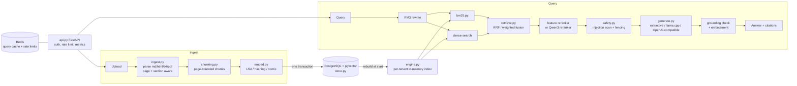

# Groundwork

A retrieval and grounded-answer engine in Python, built around measuring retrieval quality and citation grounding, not just serving answers.

[](https://github.com/siddhaantxsingh/PROJECTS/actions/workflows/groundwork.yml)


Groundwork ingests Markdown, HTML, text and PDF (with page numbers). It retrieves with BM25 (written from scratch), dense vectors (pgvector) or a hybrid of the two, and returns answers in which every sentence cites a source chunk by document, page and section. Each citation is checked. A reproducible evaluation harness, a retrieval regression gate and a defect audit ship with it.

## Highlights

- **Hybrid retrieval with real neural embeddings.** BM25 + nomic-embed-text-v1.5 (RRF) reached NDCG@10 0.700 vs 0.627 for tuned BM25 (p = 0.005), on a 31-document sub-corpus with 80 test queries ([benchmarks](docs/benchmarks.md#real-local-models-2026-10-15)).
- **Retrieval algorithms implemented, not wrapped.** BM25, RRF and weighted fusion, RM3 query expansion and a feature reranker. On the full test split (316 queries), tuned BM25 + reranker reached NDCG@10 0.550 vs 0.470 for default BM25.
- **Per-sentence grounding check.** Unsupported, uncited and wrongly cited sentences are reported, and for LLM output they are removed. Small local LLMs ground answers poorly: only 15 % of Qwen2.5-0.5B's sentences were supported by their citations (SmolLM2-360M: 0 %, 20 queries). Enforcement makes every shown sentence supported, at the cost of abstaining on 65 % of queries.
- **Layered prompt-injection defences, measured.** Against Qwen2.5-0.5B, known-style attacks succeeded 6/10 with prompt defences only and 0/10 with all defences (n = 10 per cell). The pattern scanner alone detected 0/200 paraphrased injections; it is defence in depth, not a boundary.
- **Multi-tenant FastAPI service.** API-key tenants, PostgreSQL + pgvector as the source of truth with one-transaction ingest, Redis cache and rate limits that degrade safely when Redis is down, usage accounting and Prometheus metrics.
- **81 tests** against real PostgreSQL + pgvector and Redis, run in CI, plus 5 opt-in tests that load the real models. 13 defects found by the benchmark, an independent review and a downstream browser test, each fixed with a regression test ([audit](docs/audit.md)).

## Architecture



`api.py` maps each API key to a tenant and hands requests to `engine.py`. Ingest parses a file into blocks that keep page and section, chunks them without crossing a page, embeds them, and writes the document, chunks and vectors to PostgreSQL in one transaction. The query path uses an in-memory index per tenant, rebuilt from PostgreSQL at start, so BM25, RM3 and the reranker stay explicit and fast. Retrieved chunks are scanned for injections and fenced before they reach the answer provider. The grounding check then validates every cited sentence and, for LLM output, removes the ones its sources do not support. More detail is in [docs/architecture.md](docs/architecture.md).

## Quick start

Needs Python 3.11+, PostgreSQL with pgvector on `127.0.0.1:5432` (user `postgres`) and Redis on `6379`. The CI workflow uses the same two images.

```bash
docker run -d -p 5432:5432 -e POSTGRES_HOST_AUTH_METHOD=trust pgvector/pgvector:pg16
docker run -d -p 6379:6379 redis:7

cd groundwork
pip install -e '.[dev]'
pytest                                   # 81 tests; 5 local-model tests are skipped by default
./scripts/demo.sh                        # real server: upload, grounded Q&A with page refs, abstention
python -m groundwork serve --port 8080   # configuration: docs/deployment.md
```

Reproduce the full-corpus retrieval benchmark:

```bash
python benchmarks/retrieval_bench.py OUT --pg postgresql://postgres@127.0.0.1:5432/postgres
```

Opt-in local models (llama.cpp on CPU):

```bash
pip install -e '.[local]'                # llama-cpp-python
python scripts/fetch_models.py           # GGUF files into GW_MODEL_DIR
GW_RUN_LOCAL_MODELS=1 pytest tests/test_local_models.py
GW_DIM=768 GW_EMBEDDER=nomic GW_LLM_PROVIDER=llamacpp python -m groundwork serve
```

A recorded demo run is in [test-logs/demo-2026-10-14.txt](test-logs/demo-2026-10-14.txt).

## Results

Dataset: pystdlib, a known-item retrieval set built from CPython 3.13 standard-library docstrings (122 documents, 634 queries, dev/test split, one relevant section per query). Everything was tuned on dev; numbers below are on test. Full tables and protocol: [docs/benchmarks.md](docs/benchmarks.md).

**Full corpus, offline retrievers** (316 test queries, 2 vCPU shared container):

| Configuration | NDCG@10 [95 % CI] | MRR@10 | Recall@10 |
|---|---|---|---|
| BM25, default parameters | 0.470 [0.428, 0.512] | 0.404 | 0.677 |
| BM25, tuned on dev | 0.528 [0.483, 0.571] | 0.472 | 0.703 |
| BM25 + RM3 | 0.549 [0.507, 0.590] | 0.484 | 0.753 |
| BM25 + feature reranker | 0.550 [0.506, 0.592] | 0.494 | 0.725 |
| Dense LSA-384 | 0.351 [0.311, 0.390] | 0.283 | 0.570 |
| Hybrid RRF (LSA) | 0.464 [0.422, 0.504] | 0.389 | 0.703 |

**Neural models, 31-document sub-corpus** (80 test queries, shared 4 vCPU machine under heavy load, no GPU). These are not comparable with the full-corpus table.

| Configuration | NDCG@10 [95 % CI] | Recall@10 | p vs BM25 |
|---|---|---|---|
| BM25 (tuned) | 0.627 [0.541, 0.711] | 0.825 | — |
| Dense LSA-384 | 0.505 [0.421, 0.583] | 0.775 | 0.0005 (worse) |
| Dense nomic-embed-text-v1.5 | 0.683 [0.607, 0.758] | 0.925 | 0.16 |
| Hybrid RRF (nomic) | 0.700 [0.619, 0.775] | 0.913 | 0.005 |
| Hybrid weighted (nomic) + feature reranker | 0.710 [0.633, 0.784] | 0.913 | 0.007 |

**Grounded generation** (first 20 sub-corpus test queries; deterministic metrics, no LLM judge):

| Provider | Answered / 20 | Groundedness |
|---|---|---|
| Extractive (default) | 18 | 1.00 (by construction) |
| Qwen2.5-0.5B, raw | 13 | 0.15 |
| Qwen2.5-0.5B + enforcement + attribution | 7 | 1.00 |
| SmolLM2-360M, raw | 17 | 0.00 |

Other measurements:

- Extractive provider on the full test split: abstains on 6.0 % of queries, cites the labelled relevant section in 42 % of answers, 5.78 ms median end to end.
- pgvector HNSW vs exact search (3401 vectors, dim 384): Recall@10 ≥ 0.993 at `ef_search` ≥ 40 in every run.
- Query embedding with nomic took a median of about 3.5 s on the overloaded machine. Idle-machine latency was not measured.

Raw results: [`benchmarks/results/`](benchmarks/results/).

## How correctness is verified

| Layer | What it checks | Where |
|---|---|---|
| Unit and property tests (Hypothesis) | BM25 against the formula, delete ≡ never added, page-bounded chunking, fusion, RM3, metrics | `tests/test_core.py` |
| Generation and safety tests | citation parsing, fabricated or wrong citations, injection scanner, fence spoofing, output sanitising | `tests/test_generation_safety.py` |
| Integration and fault injection | real PostgreSQL + Redis: tenant isolation, atomic ingest under failure, cache invalidation, Redis outage, restart persistence | `tests/test_api.py` |
| Audit regressions | each fix fails on the code before it | `tests/test_audit_regressions.py`, [docs/audit.md](docs/audit.md) |
| Quality gate | test-split retrieval must not drop more than 0.01 below the baseline | `tests/test_regression.py`, `benchmarks/baseline.json` |
| Local models (opt-in) | real nomic, Qwen2.5, SmolLM2 and Qwen3 reranker | `tests/test_local_models.py`, [log](docs/evidence/2026-10-15/pytest-localmodel.log) |
| CI | `pytest` and `pip-audit` on GitHub Actions with pgvector and Redis services | [`.github/workflows/groundwork.yml`](../.github/workflows/groundwork.yml) |

Test inventory: [docs/testing.md](docs/testing.md).

## Design decisions

- **PostgreSQL is the source of truth; the query index is in memory.** BM25, RM3 and the reranker stay explicit and fast. The cost is start-up time, memory and one process per index ([ADR 0002](docs/decisions/0002-in-memory-query-index.md)).
- **Offline embedders by default, neural models opt-in.** The service runs with no model download; nomic and the LLMs are enabled by configuration ([ADR 0001](docs/decisions/0001-dense-retrieval-without-pretrained-models.md)).
- **Deterministic evaluation.** Model judges never count as ground truth; groundedness and citation metrics are computed, not rated ([ADR 0003](docs/decisions/0003-deterministic-evaluation.md)).
- **Chunks never cross a page**, so a citation always names exactly one page. The cost is some extra fragmentation.
- **Lexical grounding check instead of an NLI model.** Cheap and deterministic, but weaker: it can accept a sentence that recombines source words into a false statement ([limitations](docs/limitations.md)).

## Limitations and status

- **Neural results come from a 31-document sub-corpus** (80 retrieval, 20 generation and 10 injection queries per family) on an overloaded shared CPU. The full-corpus tables use only offline retrievers.
- **The small local LLMs ground answers poorly** (raw groundedness 0.15 and 0.00). The extractive provider is the better default. The OpenAI-compatible provider is tested only with a mock.
- **Qwen3 neural reranker quality was not measured**: it is implemented and unit-tested, but too slow on the shared CPU.
- Groundedness is a lexical proxy; injection detection is pattern-based.
- One known-item dataset; no multi-hop evaluation. Single process.
- **Not deployed; no real users.** The default Docker image was built and smoke-tested ([evidence](docs/evidence/2026-10-15/)); `docker compose up` was not run.

Full list: [docs/limitations.md](docs/limitations.md). Steps that need the owner (idle-machine re-run on the full corpus, larger LLM, compose stack, licence): [docs/OWNER_ACTIONS.md](docs/OWNER_ACTIONS.md).

## Repository layout

```
groundwork/
├── groundwork/            # engine: ingest, chunking, bm25, embed, retrieve, generate, safety, store, api
│   └── evaluation/        # dataset builder, metrics, retrieval and generation evaluation
├── tests/                 # unit, property, integration, regression and local-model tests
├── benchmarks/            # retrieval, injection and neural benchmarks; results/ holds raw JSON and logs
├── data/pystdlib/         # checked-in evaluation dataset (documents, queries, qrels)
├── docs/                  # architecture, benchmarks, ADRs, audit, security, evidence
├── scripts/               # demo, model fetch, Docker build and smoke test
└── Dockerfile, docker-compose*.yml
```

## Documentation

- [Architecture](docs/architecture.md) and [design decisions](docs/decisions/)
- [Benchmarks](docs/benchmarks.md) and [testing](docs/testing.md)
- [Requirements matrix](docs/requirements.md) and [audit](docs/audit.md)
- [Security and threat model](docs/security.md) and [deployment](docs/deployment.md)
- [Limitations](docs/limitations.md), [owner actions](docs/OWNER_ACTIONS.md) and [scorecard](docs/scorecard.md)
- [Changelog](CHANGELOG.md)

---

Built by Siddhant Singh ([@siddhaantxsingh](https://github.com/siddhaantxsingh)). Licence: not yet chosen.
