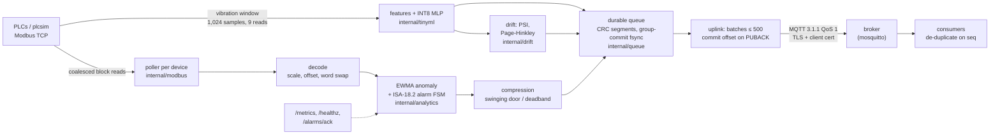

# Industrial Edge Gateway

An industrial IoT edge gateway in Go (standard library only) that polls PLCs over Modbus TCP, compresses and alarms at the edge, buffers in a crash-safe disk queue and forwards over MQTT/TLS without losing data, plus an INT8 vibration-fault classifier that runs bit-exact in Go, in C on a host, and on emulated Cortex-M.

[](https://github.com/siddhaantxsingh/PROJECTS/actions/workflows/industrial-edge.yml?query=branch%3Accr-a6e6c567-y4w7k8)


**Status:** verified locally with a real broker (mosquitto) and a simulated plant, and in a Docker smoke test. The TinyML classifier is trained and tested **only on synthetic data**, and the Cortex-M kernel has run **only in QEMU** (not cycle-accurate). There is no real machine data, no real microcontroller measurement and no deployment. This is a personal project, separate from any internship work. See [Limitations](#limitations-and-status).

## Highlights

- **No data loss across failures:** an end-to-end test with a broker outage, a `kill -9` of the gateway and a restart delivers every sequence number, with 3–9 duplicates per run from in-flight batches ([testing.md](docs/testing.md)).
- **Throughput:** 1,000 tags at 10 Hz from 20 simulated PLCs sustain 10,000 records/s to an MQTT subscriber, end-to-end latency p50 42 ms and p99 127 ms, on one 4-vCPU VM ([benchmarks.md](docs/benchmarks.md)).
- **Compression with a proven error bound:** swinging door with a feasible-slope fix keeps 38–105× fewer points on ramping signals at ±0.2–0.5, with the error bound held exactly and property-tested over 200 random signals.
- **Crash-safe queue:** CRC-framed segments with group commit, 732,799 appends/s (5,347/s with fsync per record); a crash at every byte offset of the active segment recovers exactly the complete records.
- **INT8 fault classifier, bit-exact across five targets:** 96.73 % accuracy on a held-out speed band of synthetic data; Python reference = host C = QEMU Cortex-M4 = QEMU Cortex-M3 = Go on all 3,000 test windows ([tinyml.md](docs/tinyml.md)).
- **Secure uplink:** MQTT 3.1.1 over TLS with client certificates and a password; tests confirm that a wrong password, a missing client certificate, an untrusted CA and plaintext are all refused ([security-deployment.md](docs/security-deployment.md)).

## Architecture



Each device has a goroutine that polls on its own period and merges tags into the fewest Modbus reads (50 consecutive float32 tags take one request). Samples pass through an EWMA z-score check, an ISA-18.2 alarm state machine and per-tag compression, then every record is appended to a segmented, CRC-framed log that is fsynced every `sync_ms`. The uplink reads batches from the log, publishes them at QoS 1 and commits the queue offset only when each batch's PUBACK arrives, so delivery is at least once and consumers de-duplicate on `(gateway_id, seq)`. Devices with a vibration section also feed a fixed-point feature extractor and INT8 MLP; predictions, a `fault` alarm and drift alerts go through the same queue and uplink. Modbus TCP and MQTT are implemented from their specifications. Details and failure behaviour: [docs/architecture.md](docs/architecture.md).

The same classifier exists as a dependency-free C99 kernel in [tinyml/c](tinyml/c), built for Cortex-M4/M3 and run in QEMU, and as an STM32 board image in [tinyml/board](tinyml/board) that has not yet run on hardware.

## Quick start

Tools: Go 1.24, mosquitto. The TinyML pipeline also needs `gcc-arm-none-eabi`, `qemu-system-arm` and Python with [tinyml/requirements.txt](tinyml/requirements.txt). These match the CI workflow.

```bash
cd industrial-edge
go build ./cmd/edgegw ./cmd/plcsim
./plcsim -listen 127.0.0.1:5020 -spike-every 500 &
mosquitto -p 1883 &
./edgegw -config configs/example.json            # metrics at http://127.0.0.1:9100/metrics
mosquitto_sub -t 'plant1/gw1/data' -q 1           # JSON batches
curl -X POST 'http://127.0.0.1:9100/alarms/ack?dev=tank1&tag=level'
```

Tests and pipelines:

```bash
go test -race ./internal/...          # unit and property tests (MQTT tests start mosquitto, skip if absent)
go test -count=2 ./e2e/               # broker outage + SIGKILL, PLC outage, TLS + inference
SKIP_TRAIN=1 ./tinyml/run_all.sh      # committed model: host C and QEMU Cortex-M4/M3 bit-exactness
./deploy/smoke.sh                     # Docker: gateway + TLS mosquitto + simulator, end to end
go run ./cmd/edgebench -out bench/results/$(date +%F) -broker 127.0.0.1:1883 && python3 bench/report.py $(date +%F)
```

## Results

### Gateway (one cloud VM, 4 vCPUs, Xeon @ 2.80 GHz; mosquitto 2.0.18 on the same host; simulated plant)

| metric | value | conditions |
|---|---|---|
| Pipeline throughput | 10,000 records/s delivered (200,000 in 20 s) | 20 PLCs × 50 float32 tags, polled every 100 ms, all tags changing |
| End-to-end latency p50 / p95 / p99 / max | 42 / 96 / 127 / 140 ms | sample time → subscriber, includes batching and PUBACK window |
| CPU | 0.59 cores | includes the 20 simulated PLC servers and the subscriber |
| Modbus requests | 4,020 | one coalesced 100-register read per PLC per poll |
| Queue appends, group commit (100 ms) | 732,799 records/s | 150-byte records |
| Queue appends, fsync per record | 5,347 records/s | 150-byte records |
| Queue recovery scan | 63 ms for 1,000,000 records | files in page cache |
| Swinging-door compression | level 38–51×, outflow 76–105× | deviation 0.2–0.5; max error equals the bound |

Full tables, including the flat temperature signal where deadband compresses better: [docs/benchmarks.md](docs/benchmarks.md).

### Edge ML (synthetic data, emulated hardware)

| metric | value | conditions |
|---|---|---|
| Classifier accuracy | INT8 96.73 % (macro F1 0.968), float 96.70 % | 6 classes, 3,000 test windows at a held-out 1000–1300 rpm band; MLP 22-32-16-6, 1,366 parameters |
| Bit-exactness | 3,000/3,000 windows identical | Python reference, host C, QEMU Cortex-M4, QEMU Cortex-M3, Go |
| Kernel footprint (Cortex-M4, `-O2`) | 3,044 B code + 8,140 B constants; 10,240 B buffers; < 300 B stack | 6,144 B of the constants are FFT, Hann and bit-reverse tables |
| Work per window | ≈ 490,000 instructions (FFTs ≈ 98 %) | QEMU `-icount` instruction count, **not cycles**; real-board cycles not measured |
| Go inference on the gateway host | about 47 µs per window | Xeon 2.8 GHz, shared machine |
| Simulated run-to-failure (80 machines) | 80/80 detected before failure, median lead 11.2 days, 0.109 false alarms per machine-day | EWMA z ≥ 3 baseline detects 0/80 |
| Drift | PSI alerts on a 70 % sensor-gain loss and on 300–500 rpm; none on 1,500 in-distribution windows | `internal/drift` tests |

Details: [docs/tinyml.md](docs/tinyml.md) and [docs/predictive-maintenance.md](docs/predictive-maintenance.md). Logs: [docs/evidence/2026-10-14/](docs/evidence/2026-10-14/).

## How correctness is verified

| level | what is checked |
|---|---|
| `internal/modbus` | 2,000 random frame round trips; malformed MBAP headers rejected before allocation; every function code; timeouts and re-dial |
| `internal/mqtt` | 500 QoS 1 messages through mosquitto, all PUBACKed; broker death detected; TLS refusals for wrong password, missing certificate, untrusted CAs and plaintext |
| `internal/queue` | a crash at every byte offset of the active segment recovers exactly the complete records; corruption in older segments is an error; disk cap counts drops exactly |
| `internal/analytics` | swinging-door error-bound property over 200 random signals at three deviations; EWMA flags a 15σ spike and ignores noise; alarm chatter suppression, deadband and acks |
| `internal/tinyml`, `internal/drift` | Go port bit-exact on all 3,000 windows (SHA-256 of features, inputs and logits); drift alerts and non-alerts |
| `e2e` | built gateway + simulated PLC + mosquitto: broker outage, SIGKILL, restart and a graceful stop while the broker is down, with every seq delivered; PLC outage; TLS + inference |
| `tinyml/run_all.sh`, `deploy/smoke.sh` | C on host and QEMU vs the Python reference; Docker stack end to end over TLS |

CI ([.github/workflows/industrial-edge.yml](../.github/workflows/industrial-edge.yml)) runs `gofmt`, `go vet`, unit tests with the race detector, the e2e suite twice, the QEMU bit-exactness pipeline and the Docker smoke test. CI found a real graceful-stop bug that local runs missed: the e2e test now stops the gateway while the broker is down, and it fails on the old code with 53–55 records left in the queue. Full list: [docs/testing.md](docs/testing.md).

## Design decisions

- **Standard library only, protocols from the specs.** Modbus TCP and MQTT 3.1.1 are small enough to implement and test directly, which keeps the binary static and the failure behaviour fully under test ([architecture.md](docs/architecture.md)).
- **At-least-once delivery, commit on PUBACK.** Simpler and safer than exactly-once; the cost is duplicates after a crash, which consumers remove by `seq`.
- **Group commit instead of fsync per record.** About 137× more appends per second; a power loss can lose at most `sync_ms` (100 ms) of samples, while a process crash loses nothing ([benchmarks.md](docs/benchmarks.md#durable-queue-150-byte-records)).
- **Feasible-slope swinging door.** The textbook variant exceeded its bound in the property test (0.059 at a 0.05 deviation); tracking the feasible slope interval makes the bound hold ([architecture.md](docs/architecture.md#swinging-door-error-bound)).
- **Exact integer reference for the classifier.** The Python integer model is the specification; C and Go ports must match it bit for bit, so any port bug shows up as a hash mismatch rather than an accuracy drift ([tinyml.md](docs/tinyml.md)).
- **Input PSI as well as confidence monitoring.** In the gain-loss test the model stayed confident on drifted inputs, so confidence alone missed the drift ([tinyml.md](docs/tinyml.md#drift-detection-internaldrift)).

## Limitations and status

- **Synthetic data only.** The classifier has never seen a real machine. Using a public bearing dataset is listed in [docs/OWNER_ACTIONS.md](docs/OWNER_ACTIONS.md).
- **No real microcontroller.** Cortex-M figures are QEMU instruction counts, not cycles. Measuring real latency on an STM32 Nucleo board is **blocked** on hardware; the board image builds and runs bit-exact on QEMU `netduinoplus2`, and the steps are in [docs/OWNER_ACTIONS.md](docs/OWNER_ACTIONS.md).
- **Predictive-maintenance results are simulated** and optimistic; 0.11 false alarms per machine-day is too high for production.
- **Protocols:** Modbus TCP only (no RTU, OPC UA, EtherNet/IP or S7); MQTT 3.1.1 at QoS 0/1 only. No certificate rotation without restart, no CRL/OCSP.
- **At least once, not exactly once.** Compression and alarm state are in memory and restart after a crash.
- **Single process, single host.** No clustering; benchmarks use a simulated plant on one machine. The Docker stack was smoke-tested on one machine and is not deployed anywhere.

Full list: [docs/limitations.md](docs/limitations.md). Requirement-by-requirement status: [docs/requirements.md](docs/requirements.md).

## Repository layout

```
industrial-edge/
├── cmd/          edgegw (gateway), plcsim (PLC simulator), edgebench, pdmeval, vibgen
├── internal/     modbus, mqtt, queue, analytics, gateway, tinyml, drift, plcsim, hoistsim, testutil
├── e2e/          end-to-end tests against the built binary and a real broker
├── tinyml/       training (train.py), Python reference (edgeml/), C kernel (c/), STM32 board image (board/)
├── deploy/       demo PKI script, mosquitto config, Docker smoke test
├── configs/      example gateway configuration
├── bench/        benchmark results and report generator
└── docs/         architecture, testing, benchmarks, TinyML, PdM, security, evidence
```

## Documentation

- [Architecture and failure behaviour](docs/architecture.md)
- [Testing](docs/testing.md)
- [Benchmarks](docs/benchmarks.md)
- [TinyML classifier](docs/tinyml.md) and [predictive maintenance](docs/predictive-maintenance.md)
- [Security and Docker](docs/security-deployment.md)
- [Requirements matrix](docs/requirements.md)
- [Limitations](docs/limitations.md)
- [Owner actions](docs/OWNER_ACTIONS.md)
- [Scorecard](docs/scorecard.md)

---

Built by [Siddhant Singh](https://github.com/siddhaantxsingh).
