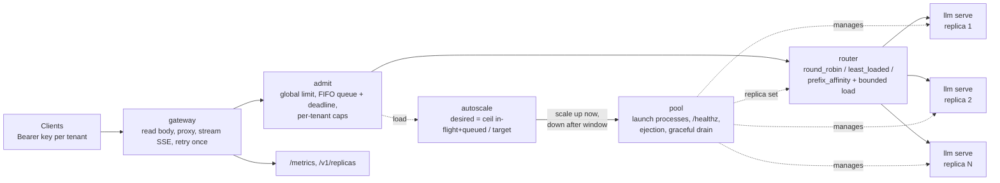

# InferX

**An inference gateway and autoscaler for LLM engine replicas, in Go with only the standard library: KV-cache-aware routing, admission control, health checks and process autoscaling with graceful drain.**

[](https://github.com/siddhaantxsingh/PROJECTS/actions/workflows/inferx.yml?query=branch%3Accr-a6e6c567-y4w7k8)


An LLM engine with a paged KV cache can skip prefill for a prompt prefix it has already seen. Behind a plain load balancer, requests that share a system prompt or file header scatter across replicas, and each replica keeps evicting what the others need. InferX sits in front of several [`llm-inference-engine`](../llm-inference-engine) processes (or anything that speaks OpenAI-style `/v1/completions`), sends requests with the same prefix to the same replica without overloading it, queues or sheds load it cannot serve, and launches or drains replica processes as load changes.

**Status:** CPU scope done; all tests pass in CI with `-race`. GPU replicas are BLOCKED (no GPU available).

## Highlights

- **Prefix-affinity routing with bounded load.** Consistent hashing on the prompt prefix (64 virtual nodes per replica), skipping any replica above ⌈1.25 × average in-flight⌉. A test sends 100 concurrent requests with one hot prefix and checks they spread across all four replicas.
- **Measured cache benefit, reported in two regimes.** With a tiny 3M-parameter in-house model, affinity raised throughput **1.68×** over round robin (66% vs 48% prefix-cache hits). With the pretrained **SmolLM2-135M**, affinity still had the highest hit ratio in all 3 repetitions (23% vs 9%), but the throughput gain (1.07–1.16×) is **within noise** ([Results](#results)).
- **Admission control.** A global in-flight cap that follows the pool size, a bounded FIFO queue with a deadline, `503` + `Retry-After` when shedding, and per-tenant caps (`429`).
- **Autoscaling real processes.** The autoscaler launched and drained real engine replicas: 1 → 4 → 1 with the 3M model and 1 → 3 → 1 with SmolLM2-135M (3 repetitions), with **0 failed and 0 shed** requests in every run.
- **Failure handling.** Active `/healthz` checks, ejection after three consecutive proxy failures, readmission on recovery, and one retry on another replica for connection failures before any byte reached the client.
- **No dependencies.** Standard library only; `go test -race` runs in CI and found a real data race in process retirement ([testing](docs/testing.md#what-testing-caught-while-developing)).

## Architecture



A request is authenticated by its tenant key, then passes `admit`: the global in-flight limit is `max_inflight_per_replica` × the current replica count, excess requests wait in a bounded queue up to `max_wait_ms`, then get `503`; a tenant over its own cap gets `429` at once. The `router` picks a replica; under `prefix_affinity` it hashes the first `prefix_bytes` bytes of the prompt onto a ring and walks past replicas that are over the load bound. The `gateway` forwards the body unchanged and flushes streamed chunks as they arrive, tagging the response with `X-Inferx-Replica`. The `pool` starts replica processes on free ports, admits them once `/healthz` answers, ejects failing ones, and stops a retiring replica (SIGINT, then SIGKILL after 5 s) only after its in-flight requests finish. The `autoscale` loop sizes the pool from in-flight plus queued requests: up immediately, down one replica per tick after a stabilization window.

Details: [design.md](docs/design.md).

## Quick start

Requirements: Go 1.22+. The tests need nothing else: they use a simulated engine (`internal/fake`) with a block-level prefix cache and fault injection.

```sh
cd inferx
go vet ./... && go test -race ./...       # what CI runs (plus a gofmt check)
```

Run the gateway in front of real engine replicas (needs [`llm-inference-engine`](../llm-inference-engine) built, with `models/small.llmw` and `models/tokenizer.json`; paths are set in [`configs/example.json`](configs/example.json)):

```sh
go build -o inferx ./cmd/inferx
./inferx -config configs/example.json      # listens on 127.0.0.1:8080, launches llm serve replicas
curl -N localhost:8080/v1/completions -H 'Authorization: Bearer change-me-team-a' \
  -d '{"prompt":"import os\n","max_tokens":16,"stream":true}'
curl localhost:8080/v1/replicas            # replica set and load
```

Benchmarks (start replicas, run `cmd/loadgen`, write results under `bench/results/`):

```sh
bench/run.sh 2026-10-14                    # 3M in-house model replicas
bench/run_smollm2.sh 2026-10-15 3          # SmolLM2-135M replicas, 3 repetitions (model file required)
```

## Results

Workload for both runs: 4 real `llm serve` replicas with one CPU thread and a 160-block (2,560-token) KV pool each, so the cache is under pressure; 16 shared prefixes of held-out Python code (~600 bytes each), one chosen at random per request, plus a unique one-line suffix; streaming, `max_tokens` 16. Hit ratio is the share of prompt tokens the engines report as served from cache.

**Tiny 3M-parameter in-house model** (2026-10-14; 4-vCPU VM; 16 clients; one 40 s run per policy):

| Policy | requests/s | Prefix-cache hit ratio | TTFT p50 / p99 |
|---|---|---|---|
| round_robin | 18.3 | 48% | 256 / 1181 ms |
| least_loaded | 22.0 | 47% | 207 / 857 ms |
| **prefix_affinity** | **30.6** (1.68×) | **66%** | **197** / 1224 ms |

**Pretrained SmolLM2-135M-Instruct** (2026-10-15; shared 4-vCPU machine with 1-minute load average 17–117 from other jobs; 8 clients; 120 s per run; mean and range over 3 repetitions):

| Policy | requests/s | Prefix-cache hit ratio | TTFT p50 |
|---|---|---|---|
| round_robin | 0.18 (0.16–0.21) | 9% (3–16) | 23.4 s |
| least_loaded | 0.19 (0.16–0.23) | 16% (12–22) | 26.5 s |
| **prefix_affinity** | **0.20** (0.17–0.24) | **23%** (15–32) | **20.1 s** |

How to read the two:

- With the tiny model each 40 s run completed 748–1,243 requests (per-replica counts in the benchmark doc), the replicas' caches warmed up, and affinity's higher hit ratio turned into 1.68× throughput and a lower median TTFT. Least-loaded had the best TTFT p99, because it never queues behind a busy replica that holds the prefix.
- The pretrained model is about 100× slower per request on this hardware, so each 120 s run finished only 19–29 requests. Affinity had the highest hit ratio in every repetition, and higher throughput in every repetition (1.09×, 1.07×, 1.16×), but the three policies' ranges overlap. **The 1.68× result is not reproduced at this request count**; confirming it with a real model needs more cores per replica or a GPU, and longer runs.

**Autoscaling** (prefix affinity, 1–4 replicas, target 4 in flight per replica):

| Model | Load step | Replicas | Requests | Failed / shed |
|---|---|---|---|---|
| 3M in-house | 2 → 24 → 2 clients (15 s / 40 s / 30 s) | 1 → 4 → 1 | 1,911 | 0 / 0 |
| SmolLM2-135M, 3 repetitions | 1 → 12 → 1 clients (20 s / 90 s / 60 s) | 1 → 3 → 1 each time | 47, 48, 86 | 0 / 0 |

A SmolLM2 replica needs 2–25 s to load its model on this machine, and the autoscaler does not account for that, so completions dip during the first minute of the step. Full tables, timelines and caveats: [benchmarks.md](docs/benchmarks.md); raw results in [`bench/results/`](bench/results/).

## How correctness is verified

`go test -race ./...` runs 11 test functions across 4 packages in a few seconds. CI ([workflow](../.github/workflows/inferx.yml)) also enforces `gofmt` and `go vet`.

| Package | What the tests prove |
|---|---|
| `router` (5) | A prefix keeps its replica; 100 concurrent hot-prefix requests stay within the load bound; adding a fifth replica moves only about 1/5 of prefixes, all to the new replica; unhealthy replicas are skipped; least-loaded equalizes |
| `gateway` (4) | JSON and SSE passthrough (5 chunks + `[DONE]`); on fake engines, affinity's hit ratio is ≥ 0.85 and ≥ 0.15 above round robin; with limit 2, queue 2 and 150 ms wait, exactly 2 of 10 requests succeed and 8 get 503 + `Retry-After`; tenant cap gives 429; a dead replica's requests are retried and the replica ejected, then readmitted after recovery |
| `autoscale` (1) | Up at once, capped at max; no scale-down inside the window; then one replica per step down to min |
| `pool` (1) | Two real `fakeengine` processes launched and joined after `/healthz`; a retiring replica leaves routing at once but is stopped only after its in-flight request ends |

Testing also caught an invalid experiment (a fixed-stride prefix choice made round robin look as good as affinity) and a data race between two `exec.Cmd.Wait` calls. Details: [testing.md](docs/testing.md). Status per requirement: [requirements.md](docs/requirements.md).

## Design decisions

- **Consistent hashing with bounded loads** (Mirrokni, Thorup, Zadimoghaddam) instead of pure stickiness: a hot prefix cannot pin one replica, at the cost of some cache misses when the bound pushes a request onward. ([design: routing](docs/design.md#routing-internalrouter))
- **Route by bytes, not tokens.** The gateway never tokenizes; it hashes the first `prefix_bytes` bytes. Cheap and model-agnostic, but a shared prefix shorter than that spreads over several replicas.
- **Admission limit tied to pool size.** Capacity grows with replicas; a per-tenant cap answers `429` at once so one tenant cannot fill the shared queue. ([design: admission](docs/design.md#admission-control-internaladmit))
- **Retry only before the first byte.** Connection failures are retried once elsewhere; a `5xx` is passed through, because generation under sampling is not idempotent.
- **Scale up fast, down slow.** Up immediately; down only to the maximum demand seen over the stabilization window, one replica per tick, after draining. ([design: autoscaling](docs/design.md#autoscaling-internalautoscale))

## Limitations and status

- **GPU replicas: BLOCKED** (no GPU here). Replicas are CPU processes; there is no GPU-aware placement.
- **The real-model benchmark is small and noisy**: ~25 requests per run on a shared, heavily loaded machine. It confirms the hit-ratio ordering, not the throughput gain.
- **The autoscaler only counts requests.** It ignores tokens/s, KV occupancy, latency SLOs and model load time, and it launches processes on the local machine only. Scaling down can also cost cache hits it does not see (with 2 clients, 4 replicas served about 22 requests/s and 1 replica about 5/s on the 3M model).
- **Single gateway instance**, in-memory admission and routing state; static API keys; no TLS; no request hedging.

Full list: [limitations.md](docs/limitations.md).

## Repository layout

```text
inferx/
  cmd/
    inferx/       the gateway binary
    loadgen/      streaming load generator used by the benchmarks
    fakeengine/   simulated engine process for the pool tests
  internal/
    gateway/      HTTP proxy, streaming, retries, metrics
    admit/        global limit, queue, shedding, tenant caps
    router/       round robin, least loaded, prefix affinity with bounded load
    pool/         replica processes, health checks, ejection, drain
    autoscale/    replica-count control loop
    fake/         in-process simulated engine with a prefix cache
  configs/        example.json
  bench/          run.sh, run_smollm2.sh, report scripts, raw results
  docs/           design, testing, benchmarks, limitations, requirements
```

## Documentation

- [Design](docs/design.md): routing, admission, pool, autoscaling, proxying
- [Testing](docs/testing.md): what each test proves and what testing caught
- [Benchmarks](docs/benchmarks.md): both model runs, timelines, caveats
- [Requirements matrix](docs/requirements.md) · [Limitations](docs/limitations.md) · [Scorecard](docs/scorecard.md)

---

Built by [Siddhant Singh](https://github.com/siddhaantxsingh).
