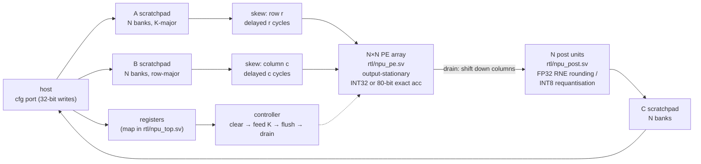

# INT8 / FP8 systolic GEMM accelerator

A parameterisable N×N output-stationary systolic array in SystemVerilog that computes C = A·B in INT8, FP8 E4M3 or FP8 E5M2, verified bit-for-bit against a Python golden model, with one processing element taken through an open-PDK RTL-to-GDS flow.

[](https://github.com/siddhaantxsingh/PROJECTS/actions/workflows/int8-fp8-accelerator.yml?query=branch%3Accr-a6e6c567-y4w7k8)


- **INT8** accumulates in INT32, with TFLite/gemmlowp requantisation (bias, zero point, ReLU).
- **FP8 E4M3 and E5M2** follow the OCP OFP8 spec. Dot products accumulate **exactly** in an 80-bit fixed-point accumulator and are rounded once to FP32, so results are correctly rounded and independent of summation order.

**Status:** verified in RTL simulation (8×8 and 4×4 arrays). In the open-source OpenROAD flow (sky130hd and Nangate45), **only the processing element (PE) block** went from RTL to routed GDSII, with 0 detailed-route DRC violations; KLayout DRC/LVS was not run. The 4×4 top level was **synthesised and placed only**: no CTS, routing or GDSII. No FPGA, tape-out or silicon. See [Limitations](#limitations-and-status).

## Highlights

- **Bit-exact verification:** 8 cocotb tests on Verilator compare every output word with the golden model, for both the 8×8 and 4×4 arrays, plus 8 tests on the reduced physical configuration ([testing.md](docs/testing.md)).
- **Correctly rounded FP8:** on 32×256×32 GEMMs the maximum error is 0.5 ULP of FP32, against 32 ULP for sequential FP32 accumulation and 26 % relative error (E4M3) or overflow (E5M2) for FP16 accumulation ([benchmarks.md](docs/benchmarks.md)).
- **Cycle-exact schedule:** K + 3N + 3 cycles per tile, asserted by the testbench; 90.5 % MAC utilisation on an 8×8 array at K = 256.
- **PE through RTL-to-GDS (sky130hd typical):** the INT8-only PE closes at 125 MHz and the INT8 + FP8 PE at 100 MHz, after routing, with 0 detailed-route DRC violations ([physical_design.md](docs/physical_design.md)).
- **Measured cost of exactness:** the FP8-capable PE is 3.5× the INT8-only PE in sky130hd (24,642 vs 7,046 µm² at 10 ns) and 2.8× in Nangate45; the 21× ECP5 LUT ratio overstated it.
- **Gate-level check of the synthesised top:** the 100,606-cell sky130hd netlist of the 4×4 top passes 8/8 bit-exact tests in gate-level simulation ([log](docs/evidence/2026-10-15/gls_sky130hd_top_synth_netlist_icarus.log)).

## Architecture



PE (r, c) owns one output element of the current N×N tile. A values move right and B values move down one PE per cycle, skewed so that A[r][k] and B[k][c] meet in PE (r, c) at cycle k + r + c. The scratchpads are banked so the array receives N A-values and N B-values per cycle, and the drain writes N C-values per cycle. In FP8 mode each product is shifted to its exact position in an 80-bit accumulator whose LSB is 2⁻³²; the post unit rounds the whole dot product once to FP32 with round-to-nearest-even. In INT8 mode the post unit applies gemmlowp's `SaturatingRoundingDoublingHighMul` and `RoundingDivideByPOT`, then the zero point, clamp and optional ReLU. Details: [docs/architecture.md](docs/architecture.md).

## Quick start

Tools: Verilator 5 (5.020 used), Yosys, Python 3 with cocotb 1.9.2 (cocotb 2.x needs Verilator 5.036 or newer). These match the CI workflow.

```bash
cd int8-fp8-accelerator
python3 -m venv .venv && .venv/bin/pip install cocotb==1.9.2 numpy pytest
export PATH=$PWD/.venv/bin:$PATH
make lint          # verilator --lint-only -Wall
make model-test    # golden-model self-tests (pytest)
make test          # 8 bit-exact cocotb tests, 8×8 array
make test-n4       # same tests, 4×4 array
make test-small    # 8 tests on the physical configuration (N = 4, 8×8×16 scratchpads)
make accuracy synth && python3 bench/report.py   # accuracy study, Yosys area, regenerates docs/benchmarks.md
```

The physical design flow runs OpenROAD-flow-scripts in a pinned Docker image and needs about 10 GB of disk; see [flow/README.md](flow/README.md).

## Results

### Throughput (cycle-exact RTL simulation; INT8 and FP8 identical)

| array | M×N×K | cycles | MAC utilisation |
|---|---|---|---|
| 8×8 | 8×8×256 | 283 | 90.5 % |
| 8×8 | 64×64×256 | 18,112 | 90.5 % |
| 4×4 | 4×4×256 | 271 | 94.5 % |
| 4×4 | 64×64×256 | 69,376 | 94.5 % |

### FP8 accumulation accuracy (32×256×32, Gaussian data quantised per tensor)

| format | this design (exact + one FP32 rounding) | sequential FP32 | sequential FP16 |
|---|---|---|---|
| E4M3 | 0.5 ULP max | 32 ULP max | 26 % max relative error |
| E5M2 | 0.5 ULP max | 8 ULP max | overflow |

### Physical design (OpenROAD-flow-scripts, academic PDKs, typical corner only, vectorless power)

| block | platform | stage reached | cell area | fastest closed clock | route DRC |
|---|---|---|---|---|---|
| PE, INT8 only | sky130hd | routed, GDSII | 7,965 µm² (8 ns) | 125 MHz | 0 |
| PE, INT8 + FP8 | sky130hd | routed, GDSII | 24,642 µm² (10 ns) | 100 MHz | 0 |
| PE, INT8 only | Nangate45 | routed | 1,287 µm² (3 ns) | closes at 3 ns, the tightest period tried | 0 |
| PE, INT8 + FP8 | Nangate45 | routed | 3,644 µm² (4 ns) | closes at 4 ns, the tightest period tried | 0 |
| top level 4×4, 8×8×16 scratchpads | sky130hd | detailed placement | 942,404 µm² placed (100,606 cells) | not closed: WNS −4.04 ns at 30 ns, before CTS | – |

"Closes" means setup and hold WNS ≥ 0 after routing and 0 detailed-route DRC violations. The top level's placement-stage critical path runs through the combinational requantisation multiplier in the post unit, which suggests about 29–30 MHz; that is a pre-CTS estimate, not a closed timing result. ORFS's internal equivalence check reports the final FP8 PE netlist identical to its synthesised netlist.

<p align="center"><br><sub>Routed INT8 + FP8 PE, sky130hd, 10 ns clock</sub></p>

Full sweeps: [docs/physical_design.md](docs/physical_design.md) and [docs/benchmarks.md](docs/benchmarks.md). Raw outputs: [flow/results/](flow/results/).

## How correctness is verified

| check | what it covers | result |
|---|---|---|
| Golden model self-tests | OCP FP8 spec values, round trip of every finite code, FP32 rounding vs NumPy on 20,000 values plus ties, gemmlowp primitives | pass (`make model-test`) |
| RTL tests, 8×8 and 4×4 | partial tiles, INT8 extremes, requantisation, random E4M3/E5M2 with subnormals, NaN/inf, exact-accumulation ties, bad dimensions, cycle counts | 8/8 bit-exact on each size |
| Physical configuration | N = 4 with 8×8×16 flip-flop scratchpads, the version built by the flow | 8/8 bit-exact (`make test-small`) |
| Gate-level simulation | synthesised sky130hd 4×4 netlist, Liberty-derived zero-delay cell models, Icarus | 8/8 bit-exact, including the cycle-count test |
| Netlist equivalence | ORFS kepler-formal, final FP8 PE netlist vs synthesis netlist | identical |
| Lint | `verilator --lint-only -Wall` | clean |

CI ([.github/workflows/int8-fp8-accelerator.yml](../.github/workflows/int8-fp8-accelerator.yml)) runs lint, the model tests, all three cocotb suites, PE synthesis and the generic-gate synthesis of the 4×4 top. The test list is in [docs/testing.md](docs/testing.md).

## Design decisions

- **Exact FP8 accumulation instead of FP32 accumulation.** Results are correctly rounded and order-independent, at 3.5× the PE area in sky130hd. A cheaper FP32-accumulating PE was not built for comparison ([architecture.md](docs/architecture.md#arithmetic)).
- **Output-stationary dataflow.** Each PE keeps its accumulator for the whole K loop, so only 8-bit operands move between PEs during compute; accumulated results shift out once per tile, during the drain ([architecture.md](docs/architecture.md#dataflow)).
- **No overlap of drain and compute.** The schedule is simple and cycle-exact, but costs 3N + 3 cycles per tile; double-buffered accumulators would remove most of it.
- **Bit-exact gemmlowp requantisation.** INT8 outputs match TFLite's reference behaviour, including saturation and round-half-away-from-zero.
- **Reduced configuration for physical design.** The default 48 KiB of scratchpad cannot be built from flip-flops, so the flow builds N = 4 with 8×8×16 scratchpads and the same register map ([physical_design.md](docs/physical_design.md#configuration-that-was-built)).

## Limitations and status

- **Only the PE went RTL-to-GDS.** The 4×4 top level stopped after detailed placement. Two CTS attempts were killed by worker restarts and a full disk, and were not re-run.
- **No sign-off.** Typical corner only, vectorless power, no KLayout DRC/LVS, no SDF timing simulation, no routed-netlist gate-level simulation.
- **The top level misses timing.** WNS −4.04 ns at 30 ns before CTS, through the un-pipelined post unit. The full 8×8 design would need SRAM macros.
- **Simple host interface.** Word-by-word scratchpad writes; no AXI or DMA. M, N ≤ 64 and K ≤ 256 per call.
- **FP8 outputs are raw FP32** (no FP8 bias or scaling); INT8 requantisation is per tensor.
- **No FPGA bring-up, tape-out or silicon.** Steps to re-run the flow and finish the top level are in [docs/OWNER_ACTIONS.md](docs/OWNER_ACTIONS.md).

Full list: [docs/limitations.md](docs/limitations.md). Requirement-by-requirement status: [docs/requirements.md](docs/requirements.md).

## Repository layout

```
int8-fp8-accelerator/
├── rtl/      npu_pe.sv (PE), npu_post.sv (FP32 rounding, requantisation),
│             npu_top.sv (array, scratchpads, controller, registers)
├── model/    npu_ref.py: bit-exact golden model, plus its tests
├── tb/       cocotb testbenches (full and small physical configuration)
├── bench/    accuracy study, performance results, report generator
├── synth/    Yosys area script and results
├── flow/     OpenROAD-flow-scripts configs, wrappers, scripts and small results
└── docs/     architecture, testing, benchmarks, physical design, evidence
```

## Documentation

- [Architecture](docs/architecture.md)
- [Verification](docs/testing.md)
- [Benchmarks](docs/benchmarks.md)
- [Physical design](docs/physical_design.md) and [flow guide](flow/README.md)
- [Requirements matrix](docs/requirements.md)
- [Limitations](docs/limitations.md)
- [Owner actions](docs/OWNER_ACTIONS.md)
- [Scorecard](docs/scorecard.md)

---

Built by [Siddhant Singh](https://github.com/siddhaantxsingh).
