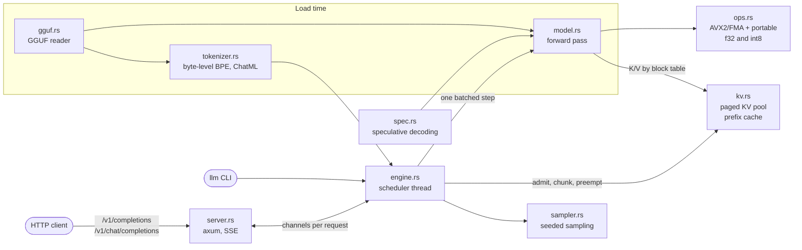

# LLM inference engine

A CPU-only LLM inference engine in Rust, with a paged KV cache, continuous batching and an OpenAI-style streaming server. It runs the pretrained **SmolLM2-135M-Instruct** model (GGUF) and matches an independent float64 reference to within float rounding.

[](https://github.com/siddhaantxsingh/PROJECTS/actions/workflows/llm-inference-engine.yml)


> **No GPU path.** The kernels are AVX2+FMA with a portable fallback, and nothing in `src/` calls CUDA. GPU execution is not implemented. The CUDA work in this repository is in [`cuda-kernels/`](../cuda-kernels/).

## Highlights

- **A real pretrained model, checked against two independent references.** On 5 prompts, SmolLM2-135M-Instruct logits are within 4.2·10⁻⁵ (relative 1.3·10⁻⁶) of a float64 NumPy forward pass. Top-1 agrees with llama.cpp at every position, and 32 greedy tokens are identical to both references on 3 prompts ([pretrained.md](docs/pretrained.md), [evidence](docs/evidence/2026-10-14/validate_smollm2_f16.json)).
- **Perplexity matches llama.cpp.** 18.8685 (engine) vs 18.8695 (llama.cpp) on the same 8,192 tokens of *Alice in Wonderland*, 512-token windows.
- **Tokenizer equal to Hugging Face `tokenizers`** on 28/28 varied texts (14,061 tokens: unicode, code, whitespace, special tokens), and to llama.cpp on 27/28. The one difference is a string of control bytes with no vocabulary token, which llama.cpp drops.
- **Batch-invariant kernels.** Every dot product sums in one fixed order, in both the AVX2 and the portable path. Batching, chunked prefill, prefix caching, preemption and speculative decoding therefore give **bit-identical** outputs to one-at-a-time decoding, and the tests demand exactly that.
- **Continuous batching raises output throughput 3.1×**: 11.0 → 34.3 tokens/s for SmolLM2 (f32, 8 requests) and 610 → 1,883 tokens/s for the small trained model (64 requests), both on a 4-vCPU VM.
- **Prefix caching** cut time to first token about 25× (9.0 s → 0.36 s) for requests sharing a 384-token prefix.

## Architecture



The server runs the engine on a dedicated thread. Each loop drains new requests, runs one `step()`, and routes token events to per-request channels, streamed as server-sent events. A step stacks decode tokens and prefill chunks from many sequences into one matrix, so every weight row is read once per step. The KV cache is a pool of 16-position blocks; full blocks are registered under a chain hash of the whole prefix, so a later request with the same prefix reuses them. When blocks run out, the newest sequence is preempted and later recomputed exactly. Details: [docs/design.md](docs/design.md).

## Quick start

Needs Rust 1.89+.

```sh
cd llm-inference-engine
cargo build --release
cargo test --release                                  # 28 tests, about 30 s

# The small model trained here is the default; no download needed.
./target/release/llm generate --prompt 'def fibonacci(n):' --max-tokens 60

# SmolLM2-135M-Instruct (271 MB, pinned sha256, into /home/user/models/ or $MODELS_DIR)
tools/fetch_model.sh smollm2-135m-instruct-f16
./target/release/llm chat --model /home/user/models/smollm2-135m-instruct-f16.gguf \
    --prompt 'What is the capital of France?'
# expected: The capital of France is Paris.
```

Serve over HTTP:

```sh
./target/release/llm serve --model /home/user/models/smollm2-135m-instruct-f16.gguf --ctx 2048 --listen 127.0.0.1:8080
curl -s localhost:8080/v1/chat/completions \
    -d '{"messages": [{"role": "user", "content": "Name three colours."}], "max_tokens": 40}'
curl -sN localhost:8080/v1/completions -d '{"prompt": "class Stack:\n", "max_tokens": 32, "stream": true}'
```

Other subcommands: `ppl` (held-out loss), `bench` (throughput vs batch size), `spec` (speculative vs greedy), `prefix-bench`, `dump`, `tokenize`. Add `--q8` for int8 weights. Reproduce the benchmarks with `bench/run.sh` (small model) and `bench/run_gguf.sh` (SmolLM2). Retraining the small model needs JAX; see `train/`.

## Results

### SmolLM2-135M-Instruct, accuracy

8,192 tokens of `bench/data/alice_ch1-3.txt`, 512-token windows ([benchmarks.md](docs/benchmarks.md)).

| weights | engine perplexity | llama.cpp perplexity | weights in memory |
|---|---|---|---|
| F16 file → f32 | 18.8685 | 18.8695 | 651 MB |
| F16 file → engine int8 (`--q8`) | 18.9171 (+0.26 %) | — | 249 MB |
| Q8_0 file → f32 | 18.9151 (+0.25 %) | 18.9603 | 651 MB |

The text is probably in the model's training data, so these are reproducible comparisons, not quality scores.

### SmolLM2-135M-Instruct, speed

4-vCPU VM **shared with other builds** (1-minute load average 2.7 to 25), 4 threads. Treat all speeds as rough; accuracy does not depend on load.

| measurement | f32 weights | int8 weights (`--q8`) |
|---|---|---|
| single-stream decode, tokens/s (3 runs) | 22.8 / 23.9 / 15.1 | 44.8 / 41.3 / 29.0 |
| output tokens/s, 8 requests, `max_seqs` 1 → 8 | 11.0 → 34.3 | 29.4 → 54.7 |

Prefix cache, 6 requests with a shared 384-token prefix: 2,400 → 480 prompt tokens computed, wall 59.2 s → 14.1 s. llama.cpp (via llama-cpp-python) decoded at 19.7–27.4 tokens/s in the same conditions; that figure is a **lower bound** for llama.cpp, not a fair comparison, so this table does not show the engine is as fast as llama.cpp.

### Small model trained here (3.0 M parameters)

| check | result |
|---|---|
| held-out loss, engine f32 vs JAX trainer (59,136 tokens) | 1.2051338 vs 1.2051337 nats/token (diff 1.8·10⁻⁸) |
| int8 weights | 3.2× smaller (13.17 → 4.12 MB), +0.01 % perplexity |
| continuous batching, 64 requests, `max_seqs` 1 → 64 | 610 → 1,883 output tokens/s (3.1×) |
| speculative decoding, k = 2 | 1.16× (63 % acceptance), output equal to greedy |

Full tables and conditions: [docs/benchmarks.md](docs/benchmarks.md). Raw results: [`bench/results/`](bench/results/).

## How correctness is verified

- **CI** ([workflow](../.github/workflows/llm-inference-engine.yml)): build, `cargo test --release` (28 tests), the engine tests again with `LLM_NO_SIMD=1` so the portable kernels must give the same answers, `cargo fmt --check`, and `clippy -D warnings`.
- **Independent references.** A float64 NumPy forward pass (`train/reference.py`, `validate/ref_numpy.py`), llama.cpp, Hugging Face `tokenizers`, and jinja2 for chat templates. Tiny GGUF fixtures written by the `gguf` package bring these expectations into CI.
- **Exactness across execution strategies.** Batching, 7-token prefill chunks, 4-token KV blocks, a 12-block pool that forces preemption, prefix caching and speculative decoding must all give exactly the one-at-a-time output. Freed KV blocks are poisoned with NaN, so a stale read cannot go unnoticed.
- **Fuzzed GGUF reader.** Every truncated prefix and every single-byte header corruption is rejected or parsed without a panic.
- **Server tests.** Concurrent HTTP requests equal offline generation; the SSE stream ends in `[DONE]`; a client that disconnects mid-stream has its KV blocks freed.
- **Mutation checks.** Six deliberate bugs (off-by-one attention, flipped RoPE sign, prefix hash ignoring its parent, and others) each fail at least one test; one known surviving mutant is documented.
- **Opt-in full-model test**: `LLM_GGUF_MODEL=... cargo test --release --test gguf -- --ignored` ([log](docs/evidence/2026-10-14/optin_smollm2_test.log)).

Details: [docs/testing.md](docs/testing.md).

## Design decisions

- **Fixed summation order over peak speed.** Batch-invariant kernels let tests demand bit-exact outputs and make speculative decoding provably equal to greedy, at the cost of some freedom in kernel tuning ([design.md](docs/design.md#batch-invariant-kernels)).
- **Preemption recomputes instead of swapping.** Simpler and exact; it repeats prefill work under KV pressure ([design.md](docs/design.md#scheduler)).
- **Chain-hashed prefix blocks.** A block's key covers every token from position 0, so equal tokens after a different prefix are never reused ([design.md](docs/design.md#paged-kv-cache-and-prefix-caching)).
- **Dequantise to f32 at load.** One code path for F32/F16/BF16/Q8_0; the engine's own per-row int8 (`--q8`) is the memory saver. A Q8_0 file is therefore no smaller in memory than F16 ([pretrained.md](docs/pretrained.md#what-was-added)).
- **Rust kept, Python for references.** The engine already existed in Rust; Python is used for the independent references and validation scripts ([pretrained.md](docs/pretrained.md#why-rust-not-ccudapython)).

## Limitations and status

- **CPU only, no GPU path.** "GPU execution" is BLOCKED / NOT IMPLEMENTED; there is nothing to run on a GPU ([OWNER_ACTIONS.md](docs/OWNER_ACTIONS.md)).
- **One pretrained family verified.** Qwen2 is tested only on a tiny synthetic file; Qwen2.5-0.5B was not run.
- **Formats.** F32, F16, BF16 and Q8_0 only; k-quants and i-quants are rejected. Weight-only int8; activations stay f32.
- **Speed.** Single-stream decode is memory-bound and slow; llama.cpp is faster. All timings come from a shared, noisy VM.
- **Speculative decoding** is greedy-only and single-sequence, outside the batched scheduler.
- **Server** has no auth, TLS or rate limits. `/v1/chat/completions` is tested through `llm chat` and the opt-in test, not over HTTP.

Full list: [docs/limitations.md](docs/limitations.md).

## Repository layout

```
llm-inference-engine/
├── src/            engine, kv, model, ops, sampler, spec, server, gguf, tokenizer; bin/llm.rs (CLI)
├── tests/          engine.rs, gguf.rs, server.rs; fixtures/ (tiny GGUF files, reference outputs)
├── validate/       NumPy reference, llama.cpp comparison, fixture generator (Python)
├── train/          JAX trainer, tokenizer builder and exporter for the small model
├── models/         small trained model, draft model and tokenizer
├── bench/          benchmark scripts, data (with provenance) and dated results
├── tools/          fetch_model.sh (Docker Hub GGUF download, pinned sha256)
└── docs/           design, testing, benchmarks, limitations, requirements, evidence
```

## Documentation

- [Pretrained models](docs/pretrained.md): fetching, GGUF, tokenizer, validation against NumPy and llama.cpp
- [Design](docs/design.md): forward pass, paged KV and prefix caching, scheduler, speculative decoding, server
- [Testing](docs/testing.md) and [benchmarks](docs/benchmarks.md)
- [Requirements matrix](docs/requirements.md) and [limitations](docs/limitations.md)
- [Owner actions](docs/OWNER_ACTIONS.md) and [scorecard](docs/scorecard.md)

---

Built by [Siddhant Singh](https://github.com/siddhaantxsingh).
