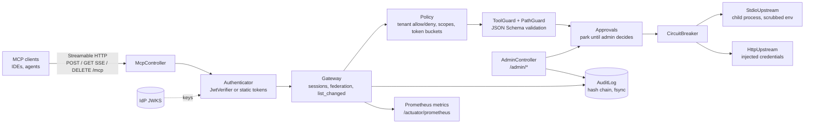

# MCP Fabric

**A Model Context Protocol gateway in Java 21 and Spring Boot 3: one MCP endpoint that federates many upstream MCP servers and adds OAuth, least-privilege policy, human approvals and a tamper-evident audit log in front of them.**

[](https://github.com/siddhaantxsingh/PROJECTS/actions/workflows/mcp-fabric.yml?query=branch%3Accr-a6e6c567-y4w7k8)


Agents and IDEs talk to MCP servers that can read files, query databases and call APIs. Connecting each client to each server directly means every server handles its own auth, and nobody sees the whole picture. MCP Fabric sits in the middle: clients connect to one Streamable HTTP endpoint; the gateway authenticates them, shows each client only the tools it may call, validates arguments, forwards calls to stdio or HTTP upstreams with the upstream's own credentials, and writes every decision to a hash-chained log.

```text
initialize                    → session (Mcp-Session-Id), protocol 2025-06-18 or 2025-03-26
tools/list                    → files__read, search__query, … (only what this client may call)
tools/call files__read {...}  → authorized, rate limited, schema-validated, forwarded, audited
resources/*, prompts/*        → routed to the owning upstream
GET /mcp (SSE)                → notifications/tools/list_changed when any upstream's catalog changes
```

## Highlights

- **OAuth 2.1 resource server per the MCP authorization spec.** JWTs checked against the IdP's JWKS (cached, rotation without restart), `iss`, `aud` (resource indicator), `exp`/`nbf`, scopes; Protected Resource Metadata (RFC 9728). A test matrix rejects `alg=none`, HS256 signed with the RSA public key, forged signatures, unknown `kid`, wrong `aud`/`iss` and expired tokens, each with its own `error_description`.
- **No token passthrough, proven by bytes.** Both test upstreams record everything they receive; the test checks that none of the 30+ client tokens issued during the run appears there, and that stdio children get only an allowlisted environment.
- **Human approvals for sensitive tools.** Calls park until an admin approves or denies; self-approval is refused (403), repeated decisions are idempotent, conflicts get 409, timeouts get `-32003`.
- **Tool-poisoning and rug-pull defence.** Tool descriptions are screened for injected instructions and invisible Unicode; definitions are pinned by SHA-256 and quarantined when an upstream changes them.
- **Resilience against real processes.** A stdio upstream killed mid-call is restarted and re-handshaken; two timeouts open the circuit breaker; 100 concurrent calls across two upstreams each get their own answer.
- **Measured overhead:** about 2.3 ms at p50 per tool call; 2,255 calls/s at 32 clients with every call fsynced to the audit log (2026-10-14 version, 4-vCPU VM; see [Results](#results)).

## Architecture



A request enters `McpController`, which authenticates it (OAuth by default; static hashed tokens only in dev mode) and binds it to a session owned by `tenant/client_id` + `sub`. The `Gateway` merges the upstreams' catalogs, namespacing tools and prompts as `upstream__name` and routing resources by URI. A `tools/call` passes policy (deny wins over allow, scopes can only narrow a tenant's tools), the rate limiter, the tool guard (pin check, path arguments) and JSON Schema validation before anything is sent upstream. Sensitive tools wait in `Approvals`. The call is forwarded through a per-upstream circuit breaker, with timeouts that send `notifications/cancelled` upstream. Every outcome, including rejections, becomes one hash-chained, fsynced audit record that stores a hash of the arguments, never the arguments.

Details: [design.md](docs/design.md).

## Quick start

Requirements: JDK 21 and Maven. The example config uses static development tokens (`fabric.auth.mode: static`), starts the bundled demo server as the stdio upstream `files`, and points the HTTP upstream `search` at `127.0.0.1:9001` (calls to it fail until something listens there; the circuit breaker then opens).

```sh
cd mcp-fabric
mvn -B package                       # builds and runs the 33 tests
java -jar target/mcp-fabric-0.1.0.jar --spring.config.additional-location=config/example.yml

# in another shell
curl -s -i -X POST localhost:8090/mcp \
  -H 'Authorization: Bearer change-me-ide' -H 'Content-Type: application/json' \
  -d '{"jsonrpc":"2.0","id":1,"method":"initialize","params":{"protocolVersion":"2025-06-18","capabilities":{},"clientInfo":{"name":"curl","version":"1"}}}'
```

Expected: `HTTP/1.1 200` with an `Mcp-Session-Id` header and `"serverInfo":{"name":"mcp-fabric",...}`. Send that header on later calls (`tools/list`, `tools/call`).

- Every setting is documented in [`config/example.yml`](config/example.yml). Static tokens are stored as SHA-256 digests: `printf %s TOKEN | sha256sum`.
- For OAuth and TLS, start from [`config/oauth-example.yml`](config/oauth-example.yml); without `mode: static` the gateway refuses to start until an issuer is configured. Keycloak and Auth0 setup: [OWNER_ACTIONS.md](docs/OWNER_ACTIONS.md).
- Benchmark (opt-in): `mvn test -Dtest=BenchmarkTest -Dbench=true`.

## Results

Measured on 2026-10-14 on a 4-vCPU cloud VM; the gateway, the test client and the upstream (a separate process speaking MCP over stdio) share those 4 vCPUs. The tool is `echo`; each gateway call is authenticated, policy-checked, rate limited, schema-validated, forwarded and audited with one fsync. Raw JSON: [`bench/results/2026-10-14/`](bench/results/2026-10-14/).

**Latency, one call at a time** (3,000 calls after 500 warm-up)

| Path | p50 | p99 | mean |
|---|---|---|---|
| Upstream direct (stdio), no gateway | 0.14 ms | 1.37 ms | 0.19 ms |
| Through MCP Fabric, audit on disk | 2.43 ms | 7.24 ms | 2.66 ms |
| Through MCP Fabric, audit on tmpfs | 2.08 ms | 7.59 ms | 2.36 ms |

**Throughput** (5 s per row)

| Concurrent clients | calls/s, audit on disk | p50 / p99 | calls/s, audit on tmpfs | p50 / p99 |
|---|---|---|---|---|
| 1 | 476 | 1.8 / 6.3 ms | 682 | 1.3 / 5.6 ms |
| 8 | 1,534 | 4.6 / 15.0 ms | 2,522 | 2.6 / 10.5 ms |
| 32 | 2,255 | 13.0 / 33.8 ms | 5,815 | 4.9 / 15.3 ms |

The per-call fsync of the audit log is the throughput limit: moving the log to tmpfs raises 32-client throughput from 2,255 to 5,815 calls/s while sequential latency barely moves.

**Caveat:** these numbers predate the security features (OAuth, pinning, path checks, approvals). A re-run on 2026-10-15 was made on the same VM under 1-minute load averages between 3.8 and 112 from other jobs; the old version's own numbers fell up to tenfold, so the cost of the new code could not be separated from noise. The re-run is recorded as inconclusive in [benchmarks.md](docs/benchmarks.md#re-run-after-the-security-changes-2026-10-15-inconclusive); a clean re-run is an owner action.

## How correctness is verified

`mvn verify` runs 34 tests: 33 pass and 1 opt-in benchmark is skipped ([log](docs/evidence/2026-10-15/mvn-verify.log)). CI runs the same command on every push that touches `mcp-fabric/` ([workflow](../.github/workflows/mcp-fabric.yml); green runs [38740636150](https://github.com/siddhaantxsingh/PROJECTS/actions/runs/38740636150) and [38782465392](https://github.com/siddhaantxsingh/PROJECTS/actions/runs/38782465392)).

| Suite | Tests | What it drives |
|---|---|---|
| `SecurityIntegrationTest` | 11 | Gateway in OAuth mode against an in-test JWKS server with real RSA-2048 and EC P-256 keys; two capturing upstreams (stdio and HTTP) |
| `FabricIntegrationTest` | 10 | Real gateway on a random port; two **separate upstream processes** over stdio and Streamable HTTP: sessions, federation, pagination, validation, rate limits, timeouts, cancellation, `list_changed`, crash restart, circuit breaker, audit tampering |
| `SecurityUnitTests` | 5 | Approval idempotency and expiry (fake clock), tool-guard patterns with no false positives on 5 ordinary descriptions, pin persistence, path guard, scope narrowing |
| `UnitTests` | 3 | Circuit breaker half-open probe, policy globs and token bucket (fake clock), audit recovery from a torn write |
| `TlsTest` | 2 | MCP handshake over TLS 1.3 with a `keytool` keystore; untrusted cert refused |
| `ExampleConfigTest` | 2 | Both example configs bind; documented tokens have the documented permissions |

Schema-violating and path-traversal calls are checked against the upstream's own call counter, so the tests prove the upstream was never called, not only that an error came back. Per-test detail: [testing.md](docs/testing.md). Status per requirement: [requirements.md](docs/requirements.md).

## Design decisions

- **Resource server only, not an authorization server.** The IdP issues tokens; the gateway validates them. Keeps token issuance out of scope, but there is no introspection, so revocation waits for token expiry; keep lifetimes short. ([design: authentication](docs/design.md#authentication-oauth-21-resource-server))
- **Scopes narrow, never widen.** The `tenant` claim selects a policy; `mcp:server:<name>` scopes can only remove upstreams from it. A misconfigured IdP cannot grant more than the tenant has.
- **Validate before forwarding.** JSON Schema 2020-12 checks run in the gateway, so a malformed call costs the upstream nothing.
- **Audit integrity over throughput.** One fsync per call makes every record durable before the response, and caps throughput at about 2,300 calls/s on the test VM. Group commit is the next step. ([design: audit log](docs/design.md#audit-log))
- **Virtual threads for approvals.** A call awaiting approval simply blocks its request thread; no callback state machine.
- **Pattern-based screening plus pinning.** Screening raises the cost of known poisoning phrasings; pinning catches any later change. Neither proves a tool safe. ([design: tool metadata](docs/design.md#tool-metadata-poisoning-and-rug-pulls))

## Limitations and status

- **OAuth tested only against an in-test IdP**, not Keycloak, Auth0 or Entra ID. TLS tested only with a self-signed keystore. Both are owner actions: [OWNER_ACTIONS.md](docs/OWNER_ACTIONS.md).
- **Benchmarks after the security changes are inconclusive** (shared, overloaded VM). The 2026-10-14 table is for the earlier version.
- **Single instance**: sessions, rate-limit buckets, circuit state and pending approvals live in memory; a restart drops them. No HA.
- **Partial protocol coverage**: no sampling, elicitation, roots, logging, completion, resource subscriptions or progress forwarding; replies are always single JSON responses.
- **Heuristic screening**: tool results are not scanned; resources and prompts are not pinned. No limit on upstream response size.
- Tested only with the bundled demo MCP server (a real separate process), not third-party servers.

Full list: [limitations.md](docs/limitations.md).

## Repository layout

```text
mcp-fabric/
  src/main/java/dev/siddhant/mcpfabric/
    gateway/    McpController, Gateway, Session, AdminController, WellKnownController, RequestSizeFilter
    auth/       JwtVerifier (Nimbus JOSE+JWT), Authenticator
    policy/     allow/deny globs, scope narrowing, token buckets
    guard/      ToolGuard (screening, pinning), PathGuard
    approval/   pending calls, approve/deny, expiry
    upstream/   StdioUpstream, HttpUpstream, CircuitBreaker
    audit/      hash-chained, fsynced JSON-lines log
    demo/       DemoServer: the MCP server used as test upstream
  src/test/     integration, security, TLS, unit and benchmark tests
  config/       example.yml (static dev mode), oauth-example.yml (OAuth + TLS)
  bench/        raw benchmark results
  docs/         design, testing, benchmarks, limitations, requirements, evidence
```

## Documentation

- [Design](docs/design.md): protocol handling, tool-call pipeline, upstreams, circuit breaker, audit chain, security model
- [Testing](docs/testing.md): what each test proves
- [Benchmarks](docs/benchmarks.md): method, results, inconclusive re-run
- [Requirements matrix](docs/requirements.md) · [Limitations](docs/limitations.md) · [Scorecard](docs/scorecard.md)
- [Owner actions](docs/OWNER_ACTIONS.md): real IdP (Keycloak/Auth0), TLS certificate, clean benchmark
- Evidence: [`docs/evidence/2026-10-15/`](docs/evidence/2026-10-15/)

---

Built by [Siddhant Singh](https://github.com/siddhaantxsingh).
