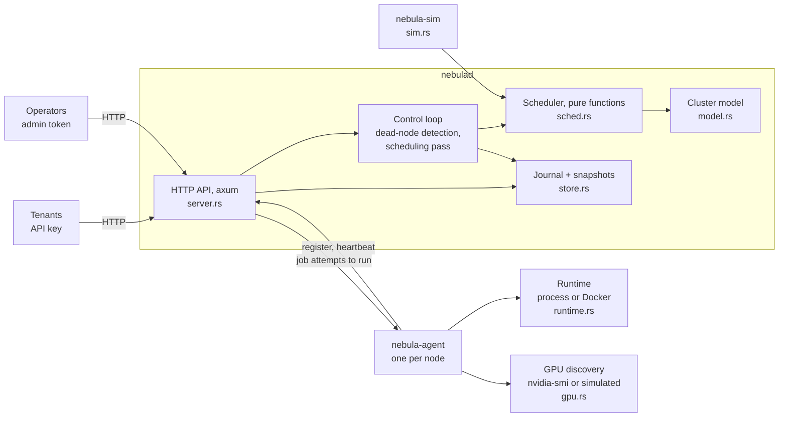

# Nebula GPU Cloud

A control plane for a multi-tenant GPU cluster, in Rust: topology-aware gang scheduling, fair share, EASY backfill, priority preemption and a crash-safe journal.

[](https://github.com/siddhaantxsingh/PROJECTS/actions/workflows/nebula-gpu-cloud.yml)


Nebula has three main binaries. `nebulad` is the scheduler and API server. `nebula-agent` runs on each node, starts job commands (as processes or hardened Docker containers) and reconciles them on every heartbeat. `nebula-sim` is a discrete-event simulator that compares scheduling policies using the same scheduler code.

**Status:** all tests pass in CI, and the Docker runtime is tested against a real Docker daemon. **There are no real GPUs on the build machine**: GPUs are simulated, `nvidia-smi` detection is tested with a stand-in script, and **real-GPU pass-through is BLOCKED** until the owner runs it on hardware ([owner actions](docs/OWNER_ACTIONS.md)). **TLS and mTLS are not implemented.**

## Highlights

- **Backfill and fair share, measured in simulation.** On 32 nodes × 8 GPUs at offered load 1.0, EASY backfill cut mean wait 3.5× against strict FIFO (5,121 s → 1,471 s), and fair share cut light tenants' wait from 1,450 s to 216 s ([benchmarks](docs/benchmarks.md)).
- **Scheduler invariants checked by property tests.** Random sequences of submits, cancels, node and GPU failures under all 16 policy combinations (300 cases): no shared GPU, no over-quota tenant, nothing on a failed node, and every queued job eventually runs.
- **Crash-safe state.** Every change is fsynced to a CRC-framed journal before the request returns. A test cuts the journal at every byte and checks that recovery yields exactly the state after the last whole record.
- **Hardened container runtime, tested on a real Docker daemon.** CPU and memory limits, read-only root, all capabilities dropped, no-new-privileges, non-root user, no network and a PID limit, checked with `docker inspect` and from inside the container. OOM kills, cancel grace periods and orphan cleanup are tested too ([evidence](docs/evidence/2026-10-15/agent_runtime_tests.log)).
- **Multi-process end-to-end test.** Real `nebulad` and two agents on loopback cover a 12-GPU gang across two nodes, preemption, node SIGKILL and requeue, GPU failure, and a control-plane restart in which a running job's command ran exactly once.
- **Control plane under load.** 100 submits/s with 256 nodes heartbeating every second and every change fsynced: submit p99 34.5 ms, heartbeat p99 6.9 ms (4-vCPU VM, simulated nodes).

## Architecture



The scheduler in `sched.rs` is a set of pure functions of the cluster state, time and policy, so the server, the simulator and the property tests run the same code. Each scheduling pass orders jobs by priority and then FIFO or fair share, places them with best fit by node and NVLink island (gangs take whole nodes, all or nothing), preempts a minimal set of lower-priority jobs when needed, and otherwise backfills behind a reservation for the head job. Every state change is a command applied through one deterministic function and appended to the journal; a scheduling pass is journaled as its decisions, so replay does not depend on the configured policy. Agents send heartbeats and receive the full list of job attempts their node must run, then start or kill local processes or containers to match. Full design: [docs/architecture.md](docs/architecture.md).

## Quick start

Needs Rust 1.89+ (the MSRV checked in CI). Docker is needed only for the container runtime and its tests.

```sh
cd nebula-gpu-cloud
cargo build --release
cargo test --release                  # 38 tests; agent_runtime tests print SKIPPED without Docker

# control plane and one agent with 8 simulated GPUs
./target/release/nebulad --config configs/example.json &
./target/release/nebula-agent --server http://127.0.0.1:7070 --token change-me-node \
    --id node-1 --gpus 8 --islands 2 &

# submit a 4-GPU job and check it
curl -s -H 'Authorization: Bearer change-me-research' -H 'content-type: application/json' \
     -d '{"gpus": 4, "est_runtime": 60, "command": ["sh", "-c", "echo $CUDA_VISIBLE_DEVICES; sleep 5"]}' \
     http://127.0.0.1:7070/v1/jobs                                    # {"id":1}
curl -s -H 'Authorization: Bearer change-me-research' http://127.0.0.1:7070/v1/jobs/1
curl -s -H 'Authorization: Bearer change-me-research' http://127.0.0.1:7070/v1/usage
curl -s http://127.0.0.1:7070/metrics

# agent with the Docker runtime
./target/release/nebula-agent --server http://127.0.0.1:7070 --token change-me-node --id node-2 \
    --gpus 8 --runtime docker --image alpine:3.20 --default-memory-mb 512 &

# policy comparison in the simulator
./target/release/nebula-sim --jobs 4000 --load 1.0 --seeds 3
```

The tokens in `configs/example.json` are placeholders. Reproduce all benchmarks with `bench/run.sh`.

## Results

**Scheduling policies** (`nebula-sim`): 32 nodes × 8 GPUs (2 NVLink islands per node), 4,000 synthetic jobs, offered load 1.0, mean of 3 seeds.

| Policy | Mean wait | p95 wait | Light tenants' wait | High-priority wait | Jobs on fewest nodes |
|---|---|---|---|---|---|
| FIFO | 5,121 s | 11,962 s | 5,140 s | 26 s | 76.4 % |
| FIFO + backfill | 1,471 s | 9,204 s | 1,450 s | 42 s | 78.7 % |
| Fair share + backfill | 1,169 s | 7,157 s | 216 s | 32 s | 77.2 % |
| ... with first-fit placement | 1,705 s | 12,778 s | 292 s | 34 s | 62.8 % |
| ... with preemption | 1,327 s | 8,941 s | 242 s | 0 s | 76.9 % |

The first-fit row is slower only because the simulator **assumes** jobs spread across islands or extra nodes run 1.1× or 1.3× slower. Without that assumption both placements give identical waits; that run is in the benchmark doc. The workload is synthetic, not a production trace.

**Control plane** (`nebula-bench`): `nebulad` in-process with real HTTP on loopback and a real fsynced journal; simulated nodes; 16 tenant clients; 4-vCPU cloud VM.

| Scenario | Nodes (GPUs) | Submits/s | Submit p50 / p99 | Heartbeat p50 / p99 |
|---|---|---|---|---|
| 50 submits/s | 64 (512) | 51 | 4.4 / 12.6 ms | 0.2 / 3.6 ms |
| 100 submits/s | 256 (2048) | 101 | 4.6 / 34.5 ms | 0.2 / 6.9 ms |
| Closed-loop flood | 64 (512) | 2,009 | 4.2 / 70.4 ms | 5.8 / 1060.1 ms |

Under the flood, 39,128 jobs queued, scheduling passes averaged 46 ms and p99 heartbeat latency reached about 1 s; the likely cause is contention on the single state lock. Full tables (loads 0.8–1.1, node failures, 256-node cluster): [docs/benchmarks.md](docs/benchmarks.md). Raw JSON: [`bench/results/`](bench/results/).

## How correctness is verified

| Suite | Tests | What it checks |
|---|---|---|
| `tests/sched.rs` | 16 | placement, gangs, backfill reservation, minimal preemption set, quotas, fair share, failures, metering; two properties over 300 cases each |
| `tests/store.rs` | 3 | replay equals live state (64 cases), crash at every byte, snapshot/journal crash window |
| `tests/sim.rs` | 3 | determinism, slow-down model, expected policy ordering on a loaded cluster |
| `tests/e2e.rs` | 2 | real processes: auth, gangs, preemption, node and GPU failure, control-plane restart |
| `tests/agent_runtime.rs` | 4 | real Docker: limits and hardening, cancel, OOM, orphan cleanup, `nvidia-smi` detection with a stand-in |
| unit tests in `src/` | 10 | `nvidia-smi` parser, `docker run` arguments, CRC-32C and torn-record decoding |

Mutations of the scheduler (backfill ignoring the reservation, unminimised preemption set, `release` not freeing GPUs, worst-fit islands) each make a test fail. CI ([workflow](../.github/workflows/nebula-gpu-cloud.yml)) builds with `--locked`, runs the tests with `NEBULA_REQUIRE_DOCKER=1`, `cargo fmt --check`, `clippy -D warnings`, short smoke runs of both benchmarks, and an MSRV build. Details: [docs/testing.md](docs/testing.md).

## Design decisions

- **Pure scheduler functions.** One implementation serves the server, the simulator and the property tests, so simulated results describe the real scheduler. The cost is a full pass per tick rather than incremental scheduling.
- **Journal decisions, not inputs.** A scheduling pass is recorded as "start X on these GPUs, preempt Y", so recovery replays exactly what happened even if the policy changes.
- **Abort on a failed journal write** rather than serve state that is not on disk.
- **Remove orphaned containers, do not adopt them.** The control plane has already requeued their jobs, so adopting them would run a job twice.
- **Preemption kills rather than checkpoints.** Simple and predictable; victims lose their progress unless the job checkpoints by itself.
- **One process, one lock.** Easy to reason about, and every change is fsynced under the lock. It is also the main throughput limit under overload.

## Limitations and status

- **BLOCKED: no real GPU.** `--gpus device=<ids>` pass-through has never run on a GPU, and nothing here has run a CUDA program. `nvidia-smi` detection was tested only with a stand-in script. The owner's check is `scripts/owner_gpu_check.sh` on an RTX 4060 ([OWNER_ACTIONS.md](docs/OWNER_ACTIONS.md)).
- **No TLS or mTLS, no per-node identity.** Static bearer tokens, with one shared node token. Run it behind a TLS-terminating proxy.
- No NVML/DCGM health checks (file-based failure injection only) and no NVLink topology detection (islands come from `--islands`).
- No HA and no fencing of partitioned nodes: a requeued job can run twice until the old agent's next heartbeat.
- One state lock: p99 latency reaches about 1 s under overload. Finished jobs are never pruned.
- Usage is metered, not billed.

Full list: [docs/limitations.md](docs/limitations.md).

## Repository layout

```
nebula-gpu-cloud/
├── src/
│   ├── model.rs  sched.rs  store.rs  server.rs   # cluster model, scheduler, journal, API
│   ├── sim.rs  runtime.rs  gpu.rs                # simulator, Docker runtime, nvidia-smi discovery
│   └── bin/      # nebulad, nebula-agent, nebula-sim, nebula-bench
├── tests/        # sched (proptest), store, sim, e2e, agent_runtime (Docker)
├── bench/        # run.sh, report.py, results/
├── configs/      # example.json
├── scripts/      # owner_gpu_check.sh
└── docs/         # architecture, benchmarks, testing, limitations, requirements, evidence
```

## Documentation

- [Architecture](docs/architecture.md): scheduler, durability, node protocol, API
- [Benchmarks](docs/benchmarks.md) and [testing](docs/testing.md)
- [Requirements matrix](docs/requirements.md) and [limitations](docs/limitations.md)
- [Owner actions](docs/OWNER_ACTIONS.md) and [scorecard](docs/scorecard.md)

---

Built by Siddhant Singh ([@siddhaantxsingh](https://github.com/siddhaantxsingh)). No licence file yet.
