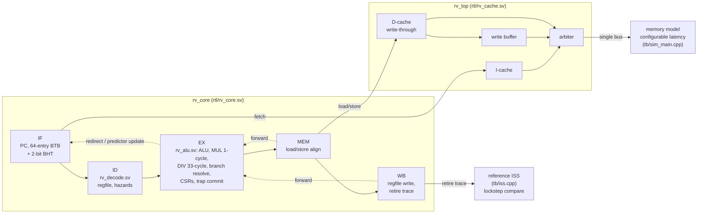

# rv_core: a verified 5-stage RV32IM CPU

A 5-stage in-order RISC-V core written from scratch in SystemVerilog, checked instruction by instruction against a reference model, with optional caches and a single-cycle baseline for comparison.

[](https://github.com/siddhaantxsingh/PROJECTS/actions/workflows/riscv-cpu.yml?query=branch%3Accr-a6e6c567-y4w7k8)


The core implements RV32IM, Zicsr, Zifencei and Zicntr in machine mode, with full forwarding, a BTB with 2-bit counters, a single-cycle multiplier, an iterative divider, precise exceptions and vectored interrupts.

**Status:** verified in simulation, with idealised memory and with caches. Timing, area and power come from a **reduced** open-source sky130hd flow (synthesis, placement, CTS, global routing, then STA). There is no detailed routing, no DRC, no gate-level simulation and **no FPGA or silicon run**. See [Limitations](#limitations-and-status).

## Highlights

- **Lockstep verification on every run.** Each retired instruction, exception and interrupt is compared live against an independent C++ ISS ([tb/iss.cpp](tb/iss.cpp)).
- **Official riscv-tests:** 64/64 pass for rv32ui/um/mi, plus 2 expected failures by design (no misaligned-access hardware, no PMP entries).
- **Cross-checked against Spike:** 400/400 random programs identical on the idealised core (335,326 events), and 400/400 on two cached builds and on the single-cycle baseline ([evidence](docs/evidence/2026-10-15/)).
- **Caches with bug injection:** I-cache and write-through D-cache with a write buffer; all suites pass in lockstep on 3 cache configurations, and 9/9 hand-written cache bugs are caught ([mutants.log](docs/evidence/2026-10-15/mutants.log)).
- **Measured, not assumed:** 2.87 CoreMark/MHz in simulation (2.43 without the branch predictor), plus a cache-size × memory-latency study ([caches_results.md](docs/caches_results.md)).
- **Honest IPC × Fmax comparison:** on sky130hd (reduced flow), the pipeline meets 43.5 MHz against 38.5 MHz for the single-cycle core, but CoreMark/s is near parity (125 vs 123), because the single-cycle multiplier is the critical path in both ([timing.md](docs/timing.md)).

## Architecture



The pipeline is a classic IF/ID/EX/MEM/WB design. EX is the commit point for exceptions and interrupts: an excepting instruction updates the trap CSRs, flushes IF and ID, and continues as a side-effect-free trap record, so older instructions in MEM and WB finish normally. Branches are predicted in IF and resolved in EX, with a 2-cycle penalty on a mispredict. In the idealised configuration the core's ports read memory combinationally. `rv_top` wraps the same core with I/D caches, a write buffer and an arbiter in front of one bus, behind which the C++ harness models memory with any latency. The Verilator harness feeds every retirement to the ISS, so any mismatch in PC, register write, memory access or trap fails the run. Details: [docs/microarchitecture.md](docs/microarchitecture.md) and [docs/caches.md](docs/caches.md).

## Quick start

Tools: Verilator 5, `riscv64-unknown-elf-gcc` with picolibc (Ubuntu: `gcc-riscv64-unknown-elf picolibc-riscv64-unknown-elf`), Yosys and Python 3. These match the CI workflow.

```bash
cd riscv-cpu
make fetch          # riscv-tests and CoreMark at pinned commits (not vendored)
make lint           # Verilator -Wall on rv_core, rv_top (two cache shapes) and rv_single
make test           # riscv-tests + random programs + interrupts + predictor variants, in lockstep
make test-cache-all # three cache configurations (memory latency 20, 1 and 50), in lockstep
make test-single    # single-cycle baseline
make bench synth report   # CoreMark, Dhrystone, CPI; Yosys synthesis; regenerates docs/benchmarks.md
```

More:

```bash
make test-spike SPIKE=/path/to/spike              # cross-check random programs against Spike
make test-cache CACHE=32:2:32:2:4:4 MEMLAT=30     # any cache shape and memory latency
tools/cache-sweep.sh out.jsonl                    # CPI and hit rates vs cache size and latency
python3 tools/mutate-cache.py                     # cache bug injection
flow/scripts/sweep_lite.sh rv_core_pd 23          # sky130hd reduced flow (see flow/env.sh.example)
obj_dir/Vrv_core program.elf                      # run any bare-metal rv32im ELF linked at 0x80000000
```

The harness's memory map, HTIF exit convention and options are documented at the top of [tb/sim_main.cpp](tb/sim_main.cpp).

## Results

All performance numbers are simulated cycles of the RTL in Verilator, compiled with riscv64-unknown-elf-gcc 13.2.0 at `-O2`. Every run had lockstep checking on and passed.

| metric | value | conditions | source |
|---|---|---|---|
| CoreMark/MHz | **2.87** (2.43 without predictor) | 2K performance run, 10 iterations, CRCs validated, idealised memory; not an official score (run < 10 s) | [benchmarks.md](docs/benchmarks.md) |
| Dhrystone | 1.22 DMIPS/MHz | riscv-tests build flags, not the ground rules | [benchmarks.md](docs/benchmarks.md) |
| CPI | 1.114 on CoreMark; 1.009–1.339 on the riscv-tests benchmarks | whole program, BTB + BHT | [benchmarks.md](docs/benchmarks.md) |
| CoreMark/MHz with caches | 0.96 (256 B) · 2.50 (1 KiB) · 2.58 (1 KiB 2-way) · 2.79 (4 KiB) | 20-cycle memory latency, 16 B lines | [caches_results.md](docs/caches_results.md) |
| FPGA-style synthesis | 6,348 LUT4 · 1,647 FF · 92 LUT-RAM16×4 · 4 DSP | Yosys `synth_ecp5`, no place and route; measured before the memory ready ports were added | [benchmarks.md](docs/benchmarks.md) |

### sky130hd timing, area and power (reduced flow)

Yosys 0.33, then OpenROAD placement, CTS and global routing, then OpenSTA at the typical corner. No detailed routing, power grid or DRC. Power is vectorless (input activity 0.1).

| design | met clock | placed std-cell area | power | CoreMark/MHz | CoreMark iterations/s at met clock |
|---|---|---|---|---|---|
| pipelined `rv_core` | 23 ns (43.5 MHz) | 328,883 µm² | 50.4 mW | 2.87 | 125 |
| single-cycle `rv_single` | 26 ns (38.5 MHz) | 152,845 µm² | 13.6 mW | 3.19 | 123 |
| `rv_top` (core + 256 B I/D caches as flops) | 23 ns (43.5 MHz) | 590,858 µm² | 53.4 mW | – | – |

The critical path in both cores runs through the single-cycle 33×33 multiplier in EX, so the pipeline buys almost nothing in throughput. A 2-stage or multi-cycle multiplier is the obvious next step; it is not done. Full sweep and critical paths: [docs/timing.md](docs/timing.md), raw data in [flow/results/pd_lite_sky130hd.jsonl](flow/results/pd_lite_sky130hd.jsonl).

## How correctness is verified

| check | what it covers | result | command |
|---|---|---|---|
| Lockstep vs reference ISS | every retired instruction, trap and interrupt, in every run below | on by default | all `make test*` targets |
| riscv-tests rv32ui/um/mi | ISA conformance | 64/64 + 2 expected failures (`ma_data`, `pmpaddr`) | `make test-isa` |
| Constrained-random programs | hazard-biased instruction mixes, MUL/DIV corner operands, CSRs, exceptions | 250/250 on 3 predictor configurations (~210,000 retired events) | `make test-random`, `make test-variants` |
| Spike cross-check | independent golden model | 400/400 on idealised, two cached and the single-cycle builds | `make test-spike` |
| Interrupt stress | precise `mepc`, no lost or repeated instruction | 8 seeds × ~12,000 random interrupts | `make test-irq` |
| Cached configurations | riscv-tests, 400 random programs, directed cache test, interrupts, self-modifying code | all pass on 3 configurations (latency 1, 20, 50) | `make test-cache-all` |
| Cache bug injection | do the checks catch real cache bugs? | 9/9 mutants caught | `python3 tools/mutate-cache.py` |
| Lint | Verilator `-Wall` on all tops | clean | `make lint` |

CI ([.github/workflows/riscv-cpu.yml](../.github/workflows/riscv-cpu.yml)) runs lint, riscv-tests, random programs with a fresh seed per run, interrupts, predictor variants, cached configurations, the single-cycle baseline, benchmarks and synthesis. A second job builds Spike from a pinned commit and cross-checks the idealised, cached and single-cycle builds. Logs from the recorded runs are indexed in [docs/evidence/2026-10-15/NOTES.md](docs/evidence/2026-10-15/NOTES.md). Full method: [docs/verification.md](docs/verification.md).

## Design decisions

- **Commit at EX, drain for system instructions.** CSR accesses, ECALL, MRET and similar wait in ID until the pipeline is empty. Traps then need no rollback and `minstret` reads exactly, at a cost of up to 3 cycles per system instruction ([microarchitecture.md](docs/microarchitecture.md)).
- **Single-cycle multiplier, iterative divider.** Simple and fast in cycles, but the multiplier sets Fmax. This is why the pipeline only reaches parity with the single-cycle core ([timing.md](docs/timing.md)).
- **Write-through D-cache with a write buffer, not write-back.** Simpler ordering and coherence with the harness, at the cost of bus bandwidth on every store ([caches.md](docs/caches.md#why-write-through-with-a-write-buffer-not-write-back)).
- **FENCE.I is the only I-cache coherence point.** Without it, self-modifying code may see stale or new instructions depending on residency; this is documented and pinned by `make test-smc` ([caches.md](docs/caches.md#self-modifying-code-what-fencei-does-and-does-not-guarantee)).
- **No return-address stack.** Returns predict the BTB's last target, which explains most of Dhrystone's 25 % mispredict rate ([benchmarks.md](docs/benchmarks.md)).

## Limitations and status

- **No FPGA run, no gate-level simulation, no silicon.** The FPGA bring-up steps are written out in [docs/OWNER_ACTIONS.md](docs/OWNER_ACTIONS.md) but have not been done.
- **Timing is from a reduced flow.** Placement, CTS and global routing with a 2022 OpenROAD build, typical corner only. No detailed routing, power grid, DRC/LVS or RC extraction. The full ORFS flow is **blocked**: its Docker image did not fit on the shared disk.
- **Pipeline vs single-cycle is near parity** (125 vs 123 CoreMark/s) while the multiplier stays single-cycle.
- **Memories are idealised.** Cache and memory reads are combinational; caches are flip-flop arrays, not SRAM macros. The bus is custom, one transaction at a time.
- **CoreMark is not an official score.** It is iterations per million simulated cycles from a 10-iteration run.
- **Machine mode only.** No U/S modes, MMU, PMP entries or debug module. Misaligned loads and stores trap.
- **No formal verification and no coverage metric.**

Full list: [docs/limitations.md](docs/limitations.md). Requirement-by-requirement status: [docs/requirements.md](docs/requirements.md).

## Repository layout

```
riscv-cpu/
├── rtl/       rv_core.sv (pipeline, CSRs, predictor), rv_decode.sv, rv_alu.sv,
│              rv_cache.sv (caches, write buffer, arbiter, rv_top), rv_single.sv
├── tb/        Verilator harness (ELF loader, HTIF, MMIO, lockstep) and reference ISS
├── tests/     directed tests: interrupt stress, cache corner cases, self-modifying code
├── tools/     random program generator, Spike comparison, test runner, sweeps, reports
├── sw/        crt0, linker script, small runtime, CoreMark port
├── synth/     Yosys script (ECP5)
├── flow/      sky130hd reduced PD flow, ORFS config (not run), results
├── results/   recorded benchmark, synthesis and cache-sweep outputs
└── docs/      design, verification, benchmarks, timing, limitations, evidence
```

## Documentation

- [Microarchitecture](docs/microarchitecture.md)
- [Verification](docs/verification.md)
- [Benchmarks](docs/benchmarks.md)
- [Caches](docs/caches.md) and [cache results](docs/caches_results.md)
- [Timing, area and power](docs/timing.md)
- [Requirements matrix](docs/requirements.md)
- [Limitations](docs/limitations.md)
- [Owner actions (FPGA, full place and route)](docs/OWNER_ACTIONS.md)
- [Evidence index](docs/evidence/2026-10-15/NOTES.md)
- [Scorecard](docs/scorecard.md)

---

Built by [Siddhant Singh](https://github.com/siddhaantxsingh).
