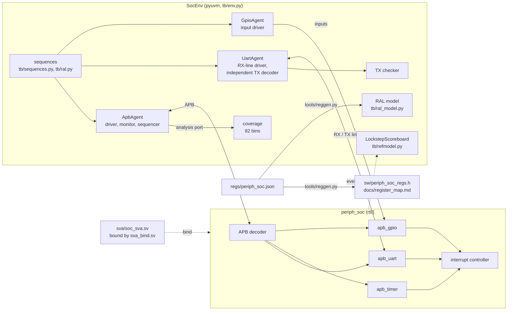

# UVM verification of an APB peripheral SoC

A UVM testbench for an APB peripheral subsystem (address decoder, UART, timer, GPIO, interrupt controller) with a cycle-accurate lockstep scoreboard, a generated register model, bound SystemVerilog assertions and bug injection that proves the checks fail when they should.

[](https://github.com/siddhaantxsingh/PROJECTS/actions/workflows/uvm-soc-verification.yml?query=branch%3Accr-a6e6c567-y4w7k8)


There are two testbenches, both on free simulators:

| testbench | language | simulator | depth |
|---|---|---|---|
| main (`tb/`) | **pyuvm** 5.0 (IEEE 1800.2 UVM in Python) on cocotb 1.9.2 | Verilator 5.020 | lockstep scoreboard, 3 agents, 82-bin coverage model, RAL, bug injection |
| compact (`sv_uvm/`) | native **SystemVerilog UVM**, Accellera UVM 2020.3.1 | Verilator 5.052 (official Docker image) | one APB agent, register-level scoreboard, 10 bins, 2 tests |

Verilator 5.020 cannot compile the SystemVerilog UVM library, so the main environment uses pyuvm, which keeps the UVM structure (agents, sequencers, analysis ports, scoreboards, phasing, ConfigDB). **No commercial simulator was used.**

## Highlights

- **Coverage closure on a defined model:** 82/82 functional coverage bins hit (100 % of the 82-bin model), merged over 10 seeds × 9 tests, all passing ([regression.json](results/2026-10-15/regression.json)).
- **Bug injection:** 12/12 injected RTL bugs caught. The first run caught only 11; the escape exposed a stimulus hole, which was then closed ([below](#what-bug-injection-found)).
- **Assertions that are shown to fire:** 23 SVA properties bound into the RTL; 0 failures on clean RTL, and each of the 21 testable properties fires on the bug it targets.
- **Generated register model:** one JSON description produces the pyuvm RAL model, a C header and the register map; `RalRegisterTest` makes 367 register checks per run, and the RAL tests alone catch both W1C bugs.
- **Native SV-UVM on Verilator 5.052:** both tests end with `UVM_ERROR : 0`; a decoder bug build ends with `UVM_ERROR : 26` and an SVA failure ([docs/sv_uvm.md](docs/sv_uvm.md)).

## Architecture



The testbench acts as the APB master in place of a CPU. The **lockstep scoreboard** runs a cycle-accurate Python model of the whole subsystem, written from the register specification, and compares PREADY, PSLVERR, PRDATA, the UART TX line, the GPIO outputs and the IRQ pin on every cycle; the first mismatch stops the test. Because the model and the RTL share an author, there are also **model-independent checks**: an independent TX decoder, sequences that assert specification behaviour directly (RX data integrity, error flags, overrun, glitch rejection, per-bit W1C, timer modes, interrupt routing), the RAL sequences and the SVA. Assertions are attached with `bind`, so the RTL is unchanged. Seeds come from cocotb's `RANDOM_SEED`. Full plan: [docs/verification_plan.md](docs/verification_plan.md).

## Quick start

Tools: Verilator 5.020 or newer and Python 3. These match the CI workflow.

```bash
cd uvm-soc-verification
python3 -m venv venv && venv/bin/pip install -r tb/requirements.txt   # cocotb 1.9.2, pyuvm 5.0.0
python3 tools/reggen.py --check                                      # generated RAL / header / docs are current
(cd tb && PATH=../venv/bin:$PATH make SIM=verilator)                 # all 9 tests, random seed
PATH=$PWD/venv/bin:$PATH python3 tools/regress.py --seeds 10 --bugs --sva-bugs --ral-bugs   # full regression
```

The SV-UVM testbench, as run in CI (Verilator 5.052 Docker image, Accellera UVM 2020.3.1):

```bash
git clone --depth 1 --branch 2020.3.1 https://github.com/accellera-official/uvm-core /tmp/uvm-core
docker run --rm -v "$PWD:$PWD" -v /tmp/uvm-core:/tmp/uvm-core -w "$PWD" \
  -e UVM_HOME=/tmp/uvm-core/src --entrypoint sh verilator/verilator:v5.052 \
  sv_uvm/run_verilator.sh /tmp/svuvm-out
```

The SV-UVM build is slow: 1,089 s wall time on a loaded shared 4-vCPU machine; each simulation then takes under a second.

## Results

Regression of 2026-10-15 (`tools/regress.py --seeds 10 --bugs --bug-seeds 2 --sva-bugs --ral-bugs`), pyuvm on Verilator 5.020:

| metric | result | source |
|---|---|---|
| Clean tests | 9 tests × 10 seeds, all pass | [regression.json](results/2026-10-15/regression.json) |
| Functional coverage | 82/82 bins of the defined model, merged over 10 seeds | [regression.json](results/2026-10-15/regression.json) |
| Injected functional bugs caught | 12/12 by the Python checks, with SVA set non-fatal | [regression_full.log](results/2026-10-15/regression_full.log) |
| SVA on clean RTL | 0 failures over 10 seeds | [regression.json](results/2026-10-15/regression.json) |
| SVA failing-first | 21/21 testable properties fire on their target bug (12 functional + 8 APB protocol bugs) | [regression_full.log](results/2026-10-15/regression_full.log) |
| RAL alone (lockstep and SVA off) | `RalW1cTest` fails on both W1C bugs | [regression.json](results/2026-10-15/regression.json) |

Native SV-UVM, Verilator 5.052 + Accellera UVM 2020.3.1:

| test | transfers checked | mismatches | coverage | UVM_ERROR / UVM_FATAL / SVA_FAIL |
|---|---|---|---|---|
| `soc_reg_test` | 200 | 0 | 9/10 bins | 0 / 0 / 0 |
| `soc_decode_test` | 250 | 0 | 10/10 bins | 0 / 0 / 0 |
| `soc_decode_test` with `+define+BUG_DECODE` | – | – | – | **26** / 0 / `SOC_DECODE_HOLE_ERRORS` |

Logs: [docs/evidence/2026-10-15/](docs/evidence/2026-10-15/).

### What bug injection found

`tools/regress.py --bugs` rebuilds the DUT with each of 12 bugs behind `ifdef`s and runs the suite. **The first run caught 11 of 12.** `BUG_UART_W1C` survived: writing bit 2 of `IRQ_ST` cleared the parity-error flag instead of the overrun flag. The tests only ever cleared all error flags at once, so the lockstep model never saw a difference the stimulus never produced. Per-bit W1C stimulus with two flags set closed the hole; the same rerun closed the last four coverage holes with a deterministic parity × baud sweep and a directed `IntcTest`.

| bug | caught by |
|---|---|
| UART parity inverted | UartTxTest, StressTest |
| TX FIFO one entry short | UartTxTest, StressTest |
| RX samples at the bit edge instead of the middle | UartRxTest, StressTest |
| W1C clears the wrong flag | UartRxTest (after the fix above) |
| UART skips its wait state | RegisterTest, UartTxTest, UartRxTest, IntcTest, StressTest |
| baud divider clamped at 2 instead of 4 | UartTxTest |
| timer reloads to 1 | TimerTest |
| prescaler off by one | IntcTest |
| GPIO W1C clears every flag | GpioTest |
| GPIO edge lost during a W1C | GpioTest |
| interrupt controller ignores the GPIO mask | GpioTest, IntcTest, StressTest |
| decoder aliases address bits 11:8 | RegisterTest |

## How correctness is verified

- **Lockstep scoreboard** against a cycle-accurate reference model, every output on every cycle.
- **Model-independent checks:** independent UART TX decoder and specification assertions inside the sequences.
- **SVA** (`sva/soc_sva.sv`), compiled with `--assert` into every run:
  - APB protocol (9): PENABLE only with PSEL, setup then access, access holds until PREADY, stable address/control/data, PSLVERR only in the last access cycle, and more;
  - peripherals (12): UART wait state, FIFO depth, baud clamp, parity, mid-bit sampling, timer prescaler, GPIO W1C, decoder holes, IRQ pin = OR of enabled pending sources;
  - no-X (2): written, but cannot fail on 2-state Verilator.
- **Failing-first evidence** for every testable check: 12 functional RTL bugs, 6 APB requester bugs injected in the driver (`APB_DRV_BUG=...`) and 2 completer bugs in the RTL.
- **RAL sequences** (`tb/ral.py`): reset values, bit-bash of every RW and W1C bit, frontdoor = backdoor = mirror, per-bit W1C.
- **CI** ([.github/workflows/uvm-soc-verification.yml](../.github/workflows/uvm-soc-verification.yml)): generated files up to date, C header compiles, Verilator `-Wall` lint of RTL + SVA, a 3-seed regression with bug, SVA and RAL failing-first checks, and the SV-UVM job on Verilator 5.052.

## Design decisions

- **pyuvm for the main environment.** It keeps UVM structure on a free simulator that cannot run the SV UVM library at version 5.020; the cost is that the main bench is Python, not SystemVerilog ([limitations](docs/limitations.md)).
- **Lockstep model plus independent checks.** A cycle-accurate model catches any deviation immediately, but shares an author with the RTL; the TX decoder, direct assertions, RAL and SVA reduce that common-mode risk.
- **One register description.** `regs/periph_soc.json` drives the RAL model, C header and docs; CI fails if they are stale ([register_map.md](docs/register_map.md)).
- **SVA restricted to what Verilator 5.020 accepts.** It rejects `##N`, named sequences and repetition ([probe log](docs/evidence/2026-10-15/verilator_5020_sva_support_probe.log)), so multi-cycle rules are written as one-cycle implications with `$past` and `$stable`.
- **Bug injection behind `ifdef`s.** Each check has a bug that must make it fail, so a passing regression means something.

## Limitations and status

- **No commercial simulator.** Neither testbench has run on Xcelium, Questa or VCS (**blocked**: no licence). Commands are in [docs/OWNER_ACTIONS.md](docs/OWNER_ACTIONS.md).
- **The SV-UVM bench is small:** one APB agent, 10 coverage bins as counters (not covergroups), `$urandom` stimulus (inline `randomize()` failed under Verilator 5.052), `UVM_NO_DPI`, no RAL.
- **Coverage is functional only**, measured against the 82-bin model defined in the [verification plan](docs/verification_plan.md). No code (line or toggle) coverage was collected.
- **SVA are checked in simulation only**; there is no formal proof. The 2 no-X properties are untested.
- **pyuvm 5.0 RAL gaps:** no predictor, backdoor write or built-in register sequences; small replacements live in `tb/ral.py`.
- **The DUT is a peripheral subsystem, not a CPU SoC.**

Full list: [docs/limitations.md](docs/limitations.md). Requirement-by-requirement status: [docs/requirements.md](docs/requirements.md).

## Repository layout

```
uvm-soc-verification/
├── rtl/       periph_soc.sv (decoder, interrupt controller), apb_uart.sv, apb_timer.sv, apb_gpio.sv
├── tb/        pyuvm environment: agents, env, sequences, reference model, RAL, tests
├── sv_uvm/    native SystemVerilog UVM testbench and Verilator run script
├── sva/       assertions, bind file, Verilator SVA support probe
├── regs/      register description (JSON)
├── tools/     reggen.py (RAL / header / docs generator), regress.py (regression, bug injection)
├── sw/        generated C register header
├── results/   recorded regression outputs
└── docs/      verification plan, register map, SV-UVM notes, requirements, evidence
```

## Documentation

- [Verification plan](docs/verification_plan.md): features, stimulus, checks, coverage bins, bug-injection plan
- [Register map](docs/register_map.md) (generated)
- [SV-UVM testbench](docs/sv_uvm.md)
- [Requirements matrix](docs/requirements.md)
- [Limitations](docs/limitations.md)
- [Owner actions](docs/OWNER_ACTIONS.md): commercial simulator, EDA Playground, formal
- [Scorecard](docs/scorecard.md)

---

Built by [Siddhant Singh](https://github.com/siddhaantxsingh).
