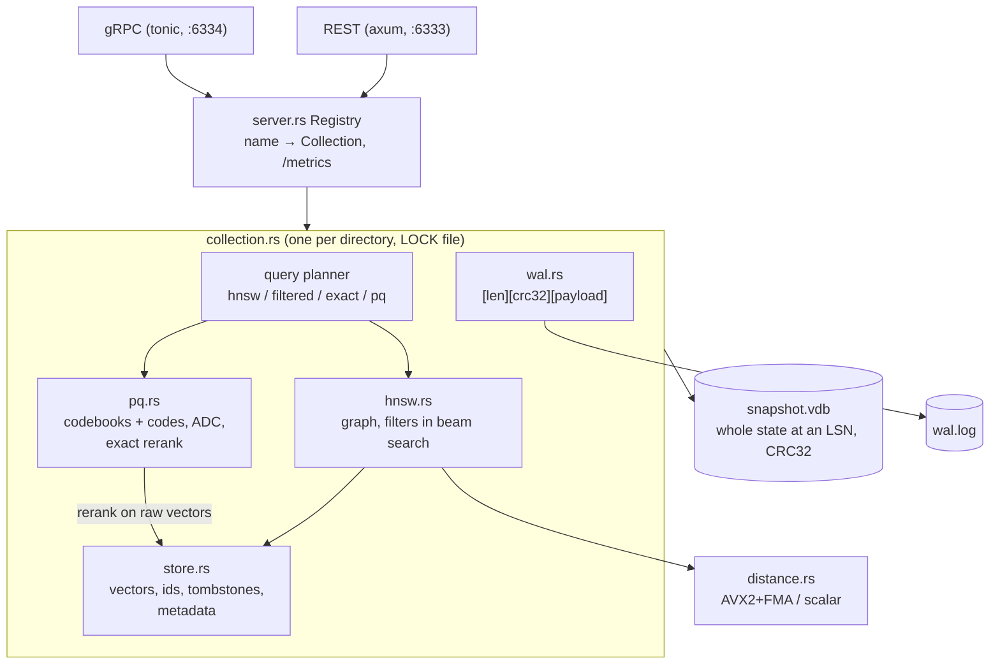

# vectordb

A persistent vector search engine written from scratch in Rust: an HNSW index, product quantization, metadata filters inside the graph search, and a write-ahead log with crash recovery, served over REST and gRPC.

[](https://github.com/siddhaantxsingh/PROJECTS/actions/workflows/vectordb.yml)


## Highlights

- **HNSW matches FAISS recall.** On 100k × 128 synthetic vectors with the same M, efConstruction and ef, recall@10 is equal to or up to 0.04 higher than FAISS `IndexHNSWFlat`, at 0.63–1.05× its single-query throughput (median about 0.7×) ([benchmarks.md](docs/benchmarks.md)).
- **No acknowledged write is lost.** A test truncates the WAL at every byte offset and recovers exactly the acknowledged prefix. Injected write, fsync and rollback failures, and a real EFBIG error from the kernel, never lose an acknowledged write ([testing.md](docs/testing.md#wal-io-fault-injection)).
- **Filtered search keeps full recall** (1.0 on `lowrank` at 50 %, 10 % and 1 % selectivity), because filters run inside the beam search, with an exact-scan fallback below 2 % selectivity ([ADR 0002](docs/decisions/0002-filters-inside-beam-search.md)).
- **Product quantization**: m = 32 codes are 15.4× smaller than the f32 vectors, with recall@10 0.95 at rerank 4. The raw vectors are kept in memory for the exact rerank, so PQ does not reduce total memory.
- **Adversarial audit**: 6 confirmed defects (one request could abort the server), each fixed with a regression test that failed before the fix ([audit.md](docs/audit.md)).
- **41 tests**, including a property test of the filtered-search contract and end-to-end REST + gRPC tests against a real server with a restart. The Docker image (156 MB) builds and passes a smoke test in CI.

## Architecture



A write is validated, appended to the WAL (and fsynced with `--sync always`), applied to the store, HNSW graph and PQ codes, and only then acknowledged. Recovery loads the latest snapshot and replays newer WAL records; a torn tail is truncated, while corruption elsewhere fails the open. Searches take a read lock and run concurrently; writes are serialised per collection. For a filtered query the planner samples up to 512 slots to estimate selectivity, then runs HNSW with `ef / selectivity` or an exact scan. Details: [docs/architecture.md](docs/architecture.md).

## Quick start

Needs Rust 1.89+. No `protoc` is needed (the `.proto` is compiled with `protox`).

```bash
cd vectordb
cargo build --release
cargo test                                     # 41 tests
./target/release/vectordb serve --data ./data --http 127.0.0.1:6333 --grpc 127.0.0.1:6334 --sync always
```

In another shell:

```bash
curl -X PUT localhost:6333/collections/docs -H 'content-type: application/json' \
     -d '{"dim": 3, "metric": "cosine", "m": 16, "ef_construction": 200, "seed": 42}'
curl -X PUT localhost:6333/collections/docs/points -H 'content-type: application/json' \
     -d '[{"id": 1, "vector": [1, 0, 0], "metadata": {"lang": "en"}},
          {"id": 2, "vector": [0, 1, 0], "metadata": {"lang": "de"}}]'
curl -X POST localhost:6333/collections/docs/search -H 'content-type: application/json' \
     -d '{"vector": [0.9, 0.1, 0], "k": 1, "filter": {"eq": ["lang", "en"]}}'
# {"hits":[{"id":1,"distance":0.0061163306,"metadata":{"lang":"en"}}],"plan":"hnsw-filtered ef=128 (selectivity≈0.500)","micros":15}

./target/release/vectordb check --data ./data   # verify graph and store invariants after recovery
```

Docker: `scripts/docker_build.sh` then `scripts/docker_smoke.sh`. Quick benchmark: `cargo run --release --bin vdb-bench -- --out /tmp/b --n 5000 --dim 32 --queries 200`.

### API

| REST | gRPC ([`proto/vectordb.proto`](proto/vectordb.proto)) | |
|---|---|---|
| `PUT /collections/:name` | — | Create; idempotent with the same config, 409 if it differs |
| `GET` / `DELETE /collections/:name` | `Stats` | Stats, or drop the collection |
| `PUT /collections/:name/points` | `Upsert` | Upsert up to 10,000 points; the whole batch is validated first |
| `GET` / `DELETE /collections/:name/points/:id` | `Delete` | Get or delete one point |
| `POST /collections/:name/search` | `Search` | `vector`, `k`; optional `ef`, `filter`, `mode` (`hnsw` / `exact` / `pq`), `rerank` |
| `POST /collections/:name/snapshot`, `/rebuild`, `/train_pq` | — | Maintenance |
| `GET /metrics`, `GET /healthz` | — | Prometheus metrics, liveness |

Filters: `{"eq": [field, value]}`, `{"in": [field, [values]]}`, `{"range": {"field": f, "gte": a, "lte": b}}`, `{"and": [...]}`, `{"or": [...]}`, `{"not": {...}}`.

## Results

One 4-vCPU cloud VM (Xeon @ 2.80 GHz), AVX2+FMA kernels, one run each (expect about ±10 % variance). Dataset `lowrank`: 100,000 synthetic vectors × 128 dims (a Gaussian mixture in a 16-d latent space, mapped to 128-d), 1,000 held-out queries, L2, M = 16, efConstruction = 200, k = 10. FAISS `IndexHNSWFlat` ran with the same parameters on the identical files and ground truth.

| ef | recall@10 | QPS (1 thread) | p50 / p99 µs | FAISS recall@10 | FAISS QPS (1 thread) |
|---|---|---|---|---|---|
| 16 | 0.9771 | 9,366 | 97 / 208 | 0.9593 | 10,999 |
| 32 | 0.9959 | 5,485 | 161 / 319 | 0.9926 | 7,886 |
| 64 | 0.9999 | 3,571 | 258 / 522 | 0.9994 | 3,809 |

| measurement (`lowrank`) | result |
|---|---|
| build, 100k inserts through the WAL (no fsync) | 49.94 s (2,003 inserts/s); FAISS 36.18 s |
| HNSW graph memory | 22.9 MB (229 B/vector), plus 51.2 MB of vectors |
| PQ, m = 32 × 256 centroids | codes + codebooks 3.3 MB (15.4× smaller than the vectors); recall@10 0.61 / 0.95 / 0.9999 at rerank 1 / 4 / 16; about 200 QPS (full scalar ADC scan) |
| filtered search, 50 % / 10 % / 1 % selectivity | recall 1.0 at all three; p50 852 µs / 12,760 µs / 17,819 µs |
| snapshot / recovery | 68.7 MB written in 0.995 s; recovered in 0.313 s with identical search results |

The harder `mixture` dataset (high intrinsic dimension) shows the same pattern: recall equal to or up to 0.02 above FAISS at every ef, with lower recall overall (0.9744 at ef = 64). Full tables, both datasets: [docs/benchmarks.md](docs/benchmarks.md). Raw JSON: [`benchmarks/results/2026-10-13/`](benchmarks/results/2026-10-13/).

## How correctness is verified

| suite | tests | what it covers |
|---|---|---|
| unit tests in `src/` | 17 | SIMD vs scalar kernels at every length 0..300; HNSW recall and graph invariants; PQ; WAL truncation at every byte and mid-log corruption |
| `tests/collection.rs` | 9 | crash at every WAL byte offset; identical results after recovery; corrupt snapshot fails the open; proptest of the filtered-search contract; concurrent readers and writers |
| `tests/api.rs` | 2 | real axum + tonic servers: REST error codes, filters, `/metrics`, gRPC round trip, graceful shutdown and restart recovery |
| `tests/audit.rs`, `tests/audit_pq_rerank.rs` | 8 | regression tests for the audit findings; the 6 confirmed-defect tests failed before their fixes ([fail-before log](test-logs/audit-fail-before.txt)) |
| `tests/wal_faults.rs`, `tests/wal_efbig.rs` | 5 | injected write / fsync / rollback errors and a real EFBIG; removing the rollback truncate fails 3 of them ([mutation log](docs/evidence/2026-10-15/wal_fault_mutation.log)) |

CI ([workflow](../.github/workflows/vectordb.yml)) runs build, tests, `fmt`, `clippy -D warnings`, a small benchmark as a smoke test, an MSRV build on Rust 1.89, and the Docker build and smoke test. Details: [docs/testing.md](docs/testing.md).

## Design decisions

- **WAL + whole-state snapshots.** Simple to reason about and checksummed end to end; the cost is about 2× peak memory during a snapshot and a full rewrite each time ([ADR 0001](docs/decisions/0001-wal-plus-snapshot.md)).
- **Filters inside the beam search.** Non-matching nodes are traversed but never returned, so a selective filter does not shrink the result list. Below 2 % selectivity an exact scan runs instead ([ADR 0002](docs/decisions/0002-filters-inside-beam-search.md)).
- **One writer per collection**, enforced by a directory lock; searches stay concurrent. Ingest does not scale with cores ([ADR 0003](docs/decisions/0003-single-writer-lock.md)).
- **Validate before logging.** Invalid input never reaches the WAL, and a batch upsert is all-or-nothing on validation errors.
- **PQ as a scan with exact rerank.** Raw vectors stay resident, so rerank restores recall (0.95 at rerank 4); there is no IVF coarse quantizer, which keeps PQ search at about 200 QPS.

## Limitations and status

- **Synthetic data only.** Both datasets are generated; no SIFT, GIST or real embeddings were available offline. Single-machine benchmarks.
- **Filtered search is slow at mid and low selectivity** (about 13–18 ms p50 at 10 % and 1 %): metadata is a `BTreeMap` per slot and the planner uses a fixed threshold, not a cost model.
- **PQ does not save memory** in this engine: codes are stored alongside the raw vectors.
- **No authentication or TLS.** Run it behind a trusted proxy ([security.md](docs/security.md)). No replication, sharding or backups beyond copying a snapshot. Not deployed.
- **Partial I/O fault coverage.** A real device fsync error (EIO) and ENOSPC were not produced.
- **Maintenance blocks traffic.** `snapshot` blocks writes; `train_pq` and `rebuild` also block searches.

Full list: [docs/limitations.md](docs/limitations.md).

## Repository layout

```
vectordb/
├── src/          distance, filter, store, hnsw, pq, wal, snapshot, collection, server, main; bin/bench.rs
├── tests/        collection, api, audit, audit_pq_rerank, wal_faults, wal_efbig
├── proto/        vectordb.proto (gRPC)
├── benchmarks/   faiss_baseline.py, render_md.py, dated results
├── scripts/      docker_build.sh, docker_smoke.sh
└── docs/         architecture, decisions (ADRs), benchmarks, testing, audit, security, evidence
```

## Documentation

- [Architecture](docs/architecture.md) and [design decisions](docs/decisions/)
- [Benchmarks](docs/benchmarks.md) and [testing](docs/testing.md)
- [Adversarial audit](docs/audit.md) and [security](docs/security.md)
- [Requirements matrix](docs/requirements.md) and [limitations](docs/limitations.md)
- [Scorecard](docs/scorecard.md)

---

Built by [Siddhant Singh](https://github.com/siddhaantxsingh).
